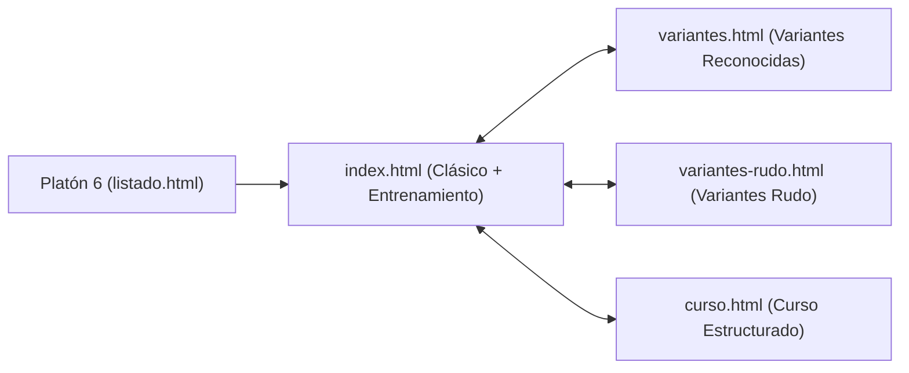

# Arquitectura — Ajedrez

*¿Cómo se comunica y fluye?*

## 1. Arquitectura General
El módulo **Ajedrez** es una aplicación web multipágina (MPA) 100% cliente alojada en `sitio-web/ajedrez/`, independiente de otros módulos de Platón 6. Sus páginas (`index.html`, `variantes.html`, `variantes-rudo.html`, `curso.html`) se enlazan entre sí mediante una barra de navegación superior compartida.

## 2. Flujo Interno en `index.html`
1. **Motor de Tablero y Reglas:** Gestiona el estado de las 64 casillas en memoria, valida los movimientos legales por pieza y actualiza el DOM del tablero tras cada jugada.
2. **Subsistema de Entrenamiento:**
   - Lee los arreglos estáticos (`NIVELES_MATERIAL`, `APERTURAS`, `TACTICAS_ESTRATEGIAS`, `MATES`).
   - Al seleccionar un ítem, inicializa la posición en el tablero y habilita los controles del reproductor (`⏮ ‹ ▶ › ⏭`) para avanzar o retroceder jugada por jugada aplicando la notación algebraica de `movidas`.
   - Sincroniza el panel lateral de texto con el botón **🔊 Escuchar explicación**, que invoca `window.speechSynthesis` con el contenido de `descripcion`.
