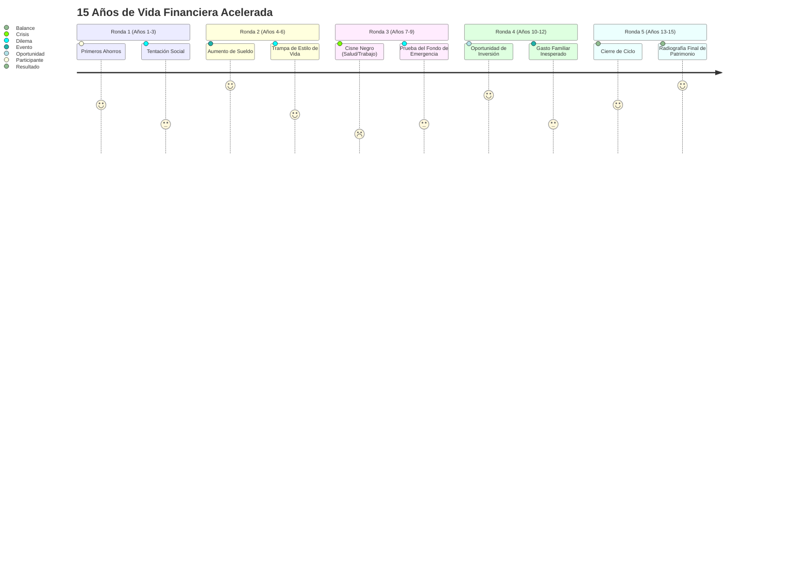

# 03. Motor de Simulación y Matriz de Eventos

## 1. El Momento Clave: La Ilusión de la Tabla Fija

Tras completar el diagnóstico de estilo de vida, la aplicación presenta una **pantalla de Presupuesto Mensual**:
* Parece una hoja de cálculo tradicional, elegante y ordenada.
* Muestra: **Ingreso Mensual Base**, **Gastos Fijos** (Vivienda, Servicios), **Gastos de Estilo de Vida** (Gastronomía, Transporte, Caprichos según lo respondido) y el **Saldo para Ahorro / Deuda**.
* En el papel, **todo parece cuadrar**. El participante ve un saldo mensual positivo (por ejemplo, +$300 USD de ahorro mensual aparente) y siente que "tiene todo bajo control".
* Se le permite hacer un último ajuste manual con deslizadores (repartir cuánto va a: Ahorro/Emergencia, Inversión, o si decide aumentar su partida de Ocio).
* Cuando presiona el botón: **"¡Iniciar el Paso del Tiempo (Simular 15 Años)!"**, la tabla fija cobra vida y la realidad golpea el presupuesto.

---

## 2. Estructura Temporal de la Simulación

Para ajustarse al tiempo del taller (7 minutos de juego efectivo), el tiempo se divide en **5 Rondas de 3 Años** (Total = 15 Años de vida financiera acelerada):

---

## 3. El Sistema de Medidores Duales

Para evitar que los participantes jueguen de forma cínica o irreal (ej: "elimino todo el ocio y no como nunca afuera para ganar más dinero"), el juego monitorea dos barras simultáneas:

### 1. Indicador Financiero: Patrimonio Neto y Liquidez
* **Liquidez / Fondo de Emergencia:** Dinero en efectivo disponible para imprevistos.
* **Patrimonio Invertido:** Dinero que crece con interés compuesto anual (ej: 7% real anual).
* **Deuda de Consumo:** Saldo en tarjetas de crédito o préstamos personales. Genera un interés compuesto negativo destructivo (ej: 25% a 35% anual).

### 2. Indicador Emocional: Bienestar y Paz Mental (0 a 100%)
* Aumenta cuando el jugador puede permitirse sus gustos elegidos (viajes, cenas, hobbies) y cuando su fondo de emergencia está lleno.
* Cae drásticamente cuando:
  * El jugador vive en privación extrema para forzar el ahorro (-Bienestar por frustración).
  * El jugador cae en deuda con tarjeta y no tiene cómo pagar (-Bienestar por ansiedad financiera).
* **Mecánica de Burnout / Colapso:** Si la barra de Bienestar cae por debajo del 20%, se desencadena automáticamente una **"Crisis de Estrés / Salud"** que obliga a pagar gastos médicos elevados o tomar licencias sin goce de sueldo, destruyendo el ahorro acumulado.

---

## 4. Matriz de Eventos Personalizados (Vínculo con el Perfil)

En cada ronda ocurren 3 tipos de sucesos:
1. **Flujo regular:** Salarios netos acumulados menos gastos fijos y de estilo de vida del período.
2. **Un Dilema de Decisión:** Obliga a elegir entre dinero, endeudamiento o felicidad.
3. **Un Imprevisto de la Realidad:** Calculado según las elecciones previas.

### Ejemplos de Eventos Vinculados al Perfil:

| Perfil / Elección Inicial | Evento que se Activa | Mecánica / Opciones |
| :--- | :--- | :--- |
| **Dilema Clave del Taller: Tecnología** (*Slide 22*) | *"Tu computador de trabajo queda obsoleto y requieres renovarlo ($600.000 CLP)"* | • **Opción 1:** Ahorrar $50.000/mes durante 12 meses (recibes $15.000 en intereses). • **Opción 2:** Comprar a crédito en 12 cuotas de $56.250 (terminas pagando $675.000 CLP). |
| **Diversificación:** *"No poner todos los huevos en la misma canasta"* (*Slide 6*) | *"Caída brusca del 20% en el sector tecnológico"* | Si el jugador invirtió 100% en acciones/cripto, sufre la pérdida íntegra. Si diversificó en DAP y Cuenta 2 AFP, el impacto se amortigua. |
| **Tarjeta de Crédito y Pago Mínimo** (*Slide 16*) | *"Fin de año: regalos, cenas y sobreendeudamiento"* | Puedes pagar el total facturado o hacer el **Pago Mínimo**. Si eliges el mínimo, se activa la capitalización de intereses (tasa 35% anual sobre saldo insoluto). |
| **Crédito Hipotecario y Seguros** (*Slide 19*) | *"Terremoto o período de cesantía imprevisto"* | Si contrataste seguro de sismo/cesantía, el seguro cubre los dividendos o daños. Si ahorraste ese costo, debes asumir el gasto con deuda o perder la vivienda. |
| **Amante de la Gastronomía** (*Slider salidas > 70*) | *"Apertura de polos gastronómicos y reuniones de fin de semana"* | Se produce un sobregasto acumulado en ocio, a menos que decida recortarlo conscientemente perdiendo bienestar social. |
| **Auto de Gama Alta** (*Elección de transporte*) | *"Falla mayor de transmisión fuera de garantía"* | Reparación obligatoria de $2.000.000 CLP. Si tiene fondo de emergencia, lo absorbe sin deuda; si no lo tiene, recurre a crédito de consumo con alto CAE. |
| **Transporte Público** (*Elección de transporte*) | *"Averías en el transporte y costos de tiempo"* | Ahorró dinero en mantenimiento, pero se le presenta la tentación de comprar un vehículo financiado. |
| **Viaje Internacional** (*Elección de vacaciones*) | *"Viaje soñado grupal con amigos/familia"* | Costo $2.500.000 CLP. Opciones:  1. Pagar contado con ahorro. 2. Pagar en 18 cuotas con intereses (Crédito de consumo). 3. No ir (fuerte caída de Felicidad). |
| **Bajo Fondo de Emergencia** | *"Urgencia médica o dental imprevista"* | Cuesta $1.000.000 CLP. Al no haber liquidez, entra automáticamente la **Tarjeta de Crédito con tasa rotativa**. |

---

## 5. La Bola de Nieve del Interés Compuesto

El simulador ilustra dos curvas matemáticas enfrentadas:

1. **La Curva Virtuosa (Inversión Sistemática):**
   * Quien destina aunque sea $100 USD al mes a inversión desde el Año 1, al llegar al Año 15 no solo tiene sus aportes ($18.000 USD), sino cerca de $32.000 USD gracias al rendimiento compuesto.
2. **La Curva Destructiva (La Deuda Rotativa):**
   * Quien financia unas vacaciones o un imprevisto de $2.000 USD con pago mínimo de tarjeta de crédito, descubre en la siguiente ronda que ya debe $3.400 USD solo en intereses sin haber amortizado el capital.

---

## 6. Diagnóstico y Radiografía Final (Año 15)

Al concluir el Año 15, la pantalla despliega un **Reporte de Vida**:
* **Calificación del Perfil:**
  * 🟢 *Libertad Financiera & Plenitud:* Patrimonio positivo, sin deudas tóxicas, bienestar > 70%.
  * 🟡 *Equilibrista Estresado:* Buen patrimonio, pero bienestar destruido por privaciones excesivas.
  * 🟠 *Viviendo al Día:* Sin deuda grave, pero sin ningún fondo de retiro ni ahorros tras 15 años de trabajo.
  * 🔴 *Atrapado en la Rueda:* Endeudado, gran parte de los ingresos se van en pagar intereses pasados.
* **Datos Reveladores para el Taller:**
  * Total generado por inversión vs. Total regalado al banco en intereses.
  * Nivel máximo de estrés alcanzado.
