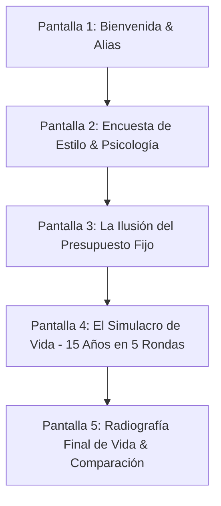

# 04. Experiencia de Usuario (UX) y Arquitectura Técnica

## 1. Principios de Diseño y Estética Visual

Para que la experiencia no se sienta como un ejercicio escolar ni como una planilla de contabilidad árida, el simulador debe adoptar una **estética "Neo-Fintech" de alta gama**:
* **Look & Feel:** Inspirado en aplicaciones financieras de vanguardia (como Nubank, Revolut, Wise o Robinhood).
* **Paleta de Colores:** Modo oscuro elegante (*slate dark*), acentos en verde esmeralda (salud financiera/inversión), violeta/azul eléctrico (estilo de vida) y coral/ámbar (alertas y deudas).
* **Tipografía:** Moderna y limpia (ej. *Inter* u *Outfit* de Google Fonts).
* **Micro-interacciones y Animaciones:** Transiciones fluidas al mover los deslizadores, números que se actualizan con efecto de contador animado, tarjetas de eventos que emergen con efecto háptico/visual.
* **Cero Fricción de Entrada:** No requiere registro con correo ni contraseña. Los participantes entran mediante un enlace web directo o escaneando un código QR desde su celular.

---

## 2. Flujo de Pantallas (Paso a Paso)

### Pantalla 1: Bienvenida y Modalidad de Juego
* **Elementos:**
  * Título impactante: *"¿Tu estilo de vida sobrevivirá a los próximos 15 años?"*
  * Campo simple de identificación: Nombre o Alias (o *"Nombre de la Pareja / Familia"* si juegan en grupo).
  * Selector de moneda local o genérica (USD o Moneda Local $).
  * Botón: *"Comenzar mi Diagnóstico"*.

### Pantalla 2: Diagnóstico de Personalidad y Gustos
* **Elementos:**
  * Tarjetas interactivas para decisiones discretas (Vivienda, Transporte, Destino de Viaje).
  * Sliders continuos táctiles con retroalimentación inmediata (Comer fuera, Tecnología, Ahorro vs Disfrute).
  * Preguntas encubiertas con tono empático y sin juzgar.
  * Barra de progreso superior (1 de 2 pasos completados).

### Pantalla 3: La Ilusión del Presupuesto Mensual
* **Elementos:**
  * Tabla limpia y moderna con gráficos de anillo (*donut chart*): Ingresos vs Gastos Fijos vs Estilo de Vida.
  * Muestra el saldo aparente disponible.
  * Controles de ajuste fino: *"¿Cuánto quieres destinar a tu fondo de emergencia o inversión?"*
  * Alerta de llamada a la acción: *"Todo se ve perfecto en el papel... Ahora veamos qué pasa cuando la vida real empieza a correr."*
  * Botón pulsante: *"Iniciar Simulación de 15 Años"*.

### Pantalla 4: La Simulación de 15 Años (El Motor en Acción)
* **Elementos en pantalla:**
  * **Línea de tiempo:** Indicador de año actual (Año 1, 2, ..., 15) y edad simulada.
  * **Medidores dobles visibles en la cabecera:**
    * *Patrimonio Neto & Liquidez* (Barra verde / azul).
    * *Bienestar Emocional & Salud Mental* (Barra de energía con emojis de estado: 😊, 😐, 😰, 🚨).
  * **Área central dinámica:** Tarjeta del período con el dilema o imprevisto actual:
    * Narrativa inmersiva conectada a sus respuestas iniciales.
    * 2 o 3 botones de decisión clara con vista previa de consecuencias:
      * Opción A: Contado (costo en ahorro).
      * Opción B: Cuotas / Tarjeta (costo en intereses).
      * Opción C: Renunciar al gusto (costo en bienestar).
  * Animación de resumen al finalizar cada ronda de 3 años.

### Pantalla 5: Radiografía Final y Comparación Grupal
* **Elementos:**
  * Insignia del Arquetipo de Vida alcanzado (*"El Visionario Libre"*, *"El Sobreviviente al Límite"*, *"El Hedonista con Deudas"*).
  * Gráfico histórico de los 15 años: Línea de Patrimonio vs Línea de Estrés/Felicidad.
  * Métricas de choque:
    * *Dinero regalado en intereses bancarios:* $X
    * *Patrimonio generado por tus inversiones:* $Y
    * *Paz mental promedio alcanzada:* Z%
  * Botón para exportar o mostrar la tarjeta de resumen para compartir en el taller.

---

## 3. Guía de Facilitación para el Tallerista (Taller de 15 Minutos)

Para asegurar que los 20 participantes se involucren activamente y compartan sus experiencias:

1. **Lanzamiento (Minuto 0):**
   * El presentador proyecta en pantalla la dirección web o el código QR.
   * Mensaje guía: *"Entren desde su celular o una pestaña de su navegador. En los primeros 3 minutos responderán con honestidad sobre sus gustos reales. Nadie los va a juzgar."*
2. **Durante la Simulación (Minuto 3 al 10):**
   * Mientras ellos juegan, el facilitador hace comentarios en vivo para generar expectativa:
     * *"Atentos a la Ronda 3... a varios les va a llegar una sorpresa."*
     * *"¿Quién ya tuvo que recurrir a la tarjeta de crédito? Pónganlo en el chat."*
3. **El Cierre y Debate (Minuto 10 al 15):**
   * El facilitador pide a 3 voluntarios con resultados opuestos que abran su micrófono:
     * *Voluntario A (Mucho dinero, pero bienestar en 25%):* *"¿Cómo te sentiste sacrificando tus salidas y tus viajes durante 15 años?"*
     * *Voluntario B (Bienestar al 100%, pero con $10.000 de deuda en tarjeta):* *"¿En qué año perdiste el control del presupuesto?"*
     * *Voluntario C (Equilibrado):* *"¿Qué te salvó cuando llegó el imprevisto de salud?"*
   * Anclaje de la lección: El presupuesto no es una prisión matemática, es un salvavidas para proteger lo que realmente valoras.

---

## 4. Arquitectura Técnica Recomendada

* **Tecnología:** Single Page Application (SPA) construida en HTML5, CSS3 moderno (Vanilla CSS con Custom Properties para temas) y JavaScript moderno (ES6+ modular o React/Vite).
* **Independencia de Servidor:** Toda la lógica de cálculo, interés compuesto y generación de eventos puede ejecutarse en el navegador del cliente (*Client-Side Engine*). Esto garantiza que la web cargue instantáneamente y no falle ante la concurrencia simultánea de los participantes.
* **Persistencia ligera:** `localStorage` para guardar el estado si alguien refresca la página por accidente durante la sesión.
* **Diseño Responsivo:** Enfoque *Mobile-First*, optimizado tanto para pantallas táctiles de teléfonos móviles como para pantallas de laptops.
