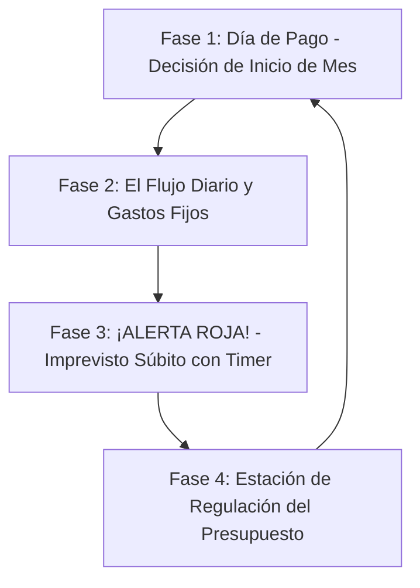

# 06. Mecánica de Simulación: El Ciclo de Vida y Decisiones Rápidas

Este documento define la arquitectura de interacción y el comportamiento de la simulación durante el taller. Resuelve la relación entre **el presupuesto**, **la tentación del dinero al inicio de mes** y **los imprevistos súbitos**.

---

## 1. La Psicología del "Día de Pago" vs. El Presupuesto Teórico

En la teoría financiera, la gente diseña su presupuesto en un papel: *"este mes ahorraré $200.000 y gastaré solo $300.000 en ocio"*. 

Sin embargo, en la vida real ocurre un fenómeno psicológico documentado: **El Sesgo del Saldo Disponible**.
* El día que depositan el sueldo, la cuenta bancaria muestra una cifra alta y atractiva.
* El cerebro experimenta una falsa sensación de abundancia: *"Tengo plata, este fin de semana me doy un gusto, total el mes recién empieza"*.
* Si no se toman decisiones conscientes en ese instante, el dinero se diluye antes de llegar a fin de mes.

---

## 2. La Anatomía de Cada Ciclo (Los 4 Momentos de la Ronda)

Cada bloque de la simulación sigue un ciclo de 4 fases que replica fielmente la psicología financiera:

---

### Fase 1: El Día de Pago (Decisión Activa de Inicio de Mes)

Apenas inicia el período, la pantalla muestra la animación de ingreso del sueldo. Antes de que el tiempo avance, el juego te pone frente a la primera encrucijada con tu dinero en mano:

> 💵 **¡DÍA DE PAGO! Tienes tu saldo íntegro en la cuenta.**
> *¿Qué orden le das a tu dinero antes de que empiece el mes?*
>
> * **[Opción 1] "Págate a ti mismo primero" (Ahorro/Inversión Automática):**
>   Apartas inmediatamente el 15% o 20% a tu Fondo de Emergencia (DAP) o Cuenta 2 de AFP.
>   *Efecto:* Aseguras el ahorro del período. Tu saldo a la vista disminuye, lo que te protege de compras por impulso. Tu Paz Mental sube (+5%).
>
> * **[Opción 2] "Me lo merezco" (Celebración / Gusto Temprano):**
>   Aprovechas que la cuenta está llena para darte ese gusto que venías postergando (cena cara, ropa o escapada de fin de semana: -$250.000 CLP).
>   *Efecto:* Tu barra de Bienestar y Felicidad salta de inmediato (+15%), pero dejas tu cuenta vulnerable y sin liquidez para el resto del mes.
>
> * **[Opción 3] "Lo dejo en la cuenta corriente y veo qué sobra a fin de mes":**
>   No apartas nada. Crees que serás disciplinado.
>   *Efecto:* Fenómeno de **Gasto Hormiga Automático**: a medida que corre el tiempo, el 10% del dinero se evapora misteriosamente en microcompras invisibles (cafés, deliveries no planificados, suscripciones olvidadas).

---

### Fase 2: El Flujo del Tiempo (Tu Presupuesto en Acción)

El tiempo empieza a correr a velocidad acelerada (mes a mes):
* Se descuentan automáticamente los **Gastos Fijos** (arriendo/dividendo, servicios, colegios, alimentación base).
* Si tienes deudas previas, se cobra la **cuota mensual de créditos**.
* Los participantes ven cómo sus medidores de dinero y bienestar van cambiando en tiempo real.

---

### Fase 3: ¡ALERTA SÚBITA! (Imprevisto con Temporizador de 15 Segundos)

A mitad del ciclo, sin previo aviso, **la pantalla se congela y entra en modo de emergencia**:
Suena una alerta visual/sonora y aparece una tarjeta central con una **barra de cuenta regresiva de 15 segundos**:

> 🚨 **¡URGENCIA DENTAL INESPERADA!**
> *"Una infección severa requiere un tratamiento de conducto y corona de urgencia. Costo: $450.000 CLP. Tienes dolor agudo y debes resolverlo hoy."*
>
> ⏱️ **Tiempo para decidir: 15... 14... 13...**
>
> * **[Opción A] Pagar con mi Fondo de Emergencia / Ahorro Líquido:**
>   *Requiere tener saldo disponible.*
>   *Impacto:* Absorbes el golpe sin deudas. Tu liquidez baja, pero tu presupuesto mensual futuro no se altera.
>
> * **[Opción B] Tarjeta de Crédito en 6 cuotas:**
>   *Impacto:* Solucionas la urgencia hoy sin desembolso inmediato, pero **alteras tu presupuesto mensual**: ahora tendrás un nuevo gasto fijo obligatorio de -$85.000 CLP/mes durante el próximo año.
>
> * **[Opción C] Posponer el tratamiento y tomar solo analgésicos:**
>   *Impacto:* No gastas dinero hoy, pero tu barra de **Paz Mental y Salud cae un -35%**, arriesgando una complicación médica el triple de costosa en el siguiente año.

*(Si el tiempo de 15 segundos expira sin respuesta, el sistema ejecuta la reacción impulsiva más habitual: endeudarse con tarjeta).*

---

### Fase 4: La Estación de Regulación (Ajuste del Presupuesto)

Una vez resuelto el imprevisto y completado el bloque de años, la simulación entra en un momento de pausa reflexiva. 

Aquí el participante tiene el **Panel de Control del Presupuesto** para maniobrar de cara al siguiente período:
1. **Regular el nivel de vida (Slider de Estilo de Vida):**
   * Si quedó endeudado con cuotas de tarjeta, puede recortar voluntariamente sus salidas y ocio para recuperar margen.
   * Si tiene superávit y su bienestar está bajo, puede aumentarlo conscientemente.
2. **Reasignar el destino del ahorro:**
   * ¿Recuperar el fondo de emergencia en un Depósito a Plazo (DAP)?
   * ¿Aprovechar de invertir en Fondos Mutuos o Cuenta 2 de AFP para buscar rentabilidad compuesta?
3. **Prepagar deudas:**
   * Usar excedentes para abonar directamente al saldo insoluto de créditos y eliminar intereses futuros.

Al terminar los ajustes, presiona **"Continuar al siguiente período"** y el ciclo se repite con nuevos desafíos de vida.

---

## 3. Matriz de Consecuencias Cruzadas (El Aprendizaje Vivencial)

Esta mecánica permite que los 20 participantes experimenten lecciones imborrables:

| Situación Vivida | Causa en el Juego | Impacto en el Taller |
| :--- | :--- | :--- |
| **"Me pilló el imprevisto con la cuenta vacía"** | En la Fase 1 eligió "Me lo merezco" o dejó la plata flotando. | En el debate reconoce: *"Si me hubiera pagado a mí mismo primero el día 1, no habría caído en la tarjeta"*. |
| **"Mi presupuesto se fue a números rojos"** | Financió 2 o 3 imprevistos en cuotas sin recortar su estilo de vida. | Ve claramente cómo la suma de cuotas pequeñas estrangula el sueldo mensual. |
| **"Tengo mucho dinero pero mi salud mental está en 20%"** | Nunca se dio un gusto en la Fase 1 y recortó todo el ocio a cero. | Descubre que un presupuesto sin espacio para el disfrute es insostenible y produce *burnout*. |
| **"El efecto salvavidas del DAP"** | Tenía 3 meses de sueldo en un Depósito a Plazo y el imprevisto no le causó ninguna deuda. | Siente el alivio y la paz mental que ninguna diapositiva teórica puede transmitir. |
