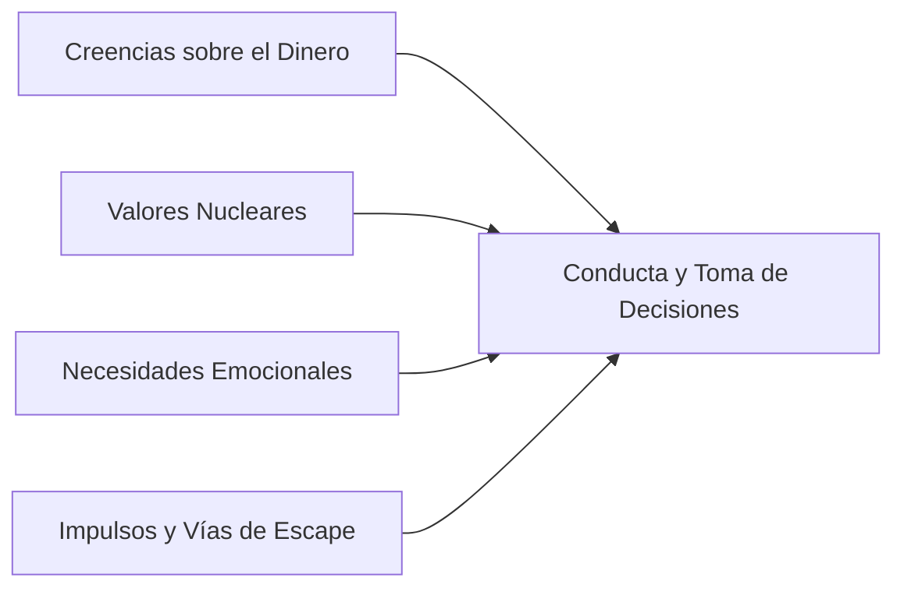

# 07. Matriz Pedagógica: Psicología, Fondos de Reserva y Catálogo de Eventos

## 1. El Motor Psicológico Subyacente

Cada participante o arquetipo no solo tiene números en su cuenta; tiene una **disposición psicológica y actitudinal** definida por 4 vectores:

1. **Creencias Nucleares:**
   * *El Dinero como Escudo:* Necesidad obsesiva de control; culpa al gastar.
   * *El Dinero como Placer / YOLO:* El futuro es incierto; el valor está en el presente.
   * *El Dinero como Estatus / Validación:* Miedo al rechazo social; necesidad de proyectar éxito.
   * *El Dinero como Motor de Libertad:* Herramienta para no depender de jefes ni deudas.
2. **Necesidades Emocionales Activas:**
   * *Búsqueda de Certeza:* Miedo a la escasez; prefiere instrumentos ultraseguros aunque rindan poco.
   * *Búsqueda de Reconocimiento / Pertenencia:* Vulnerabilidad a comprar lo que compra el entorno.
   * *Búsqueda de Gratificación Inmediata:* Impaciencia temporal; incapacidad de postergar el deseo.
3. **Impulsos Conductuales en Juego:**
   * *Consumo Compensatorio ("Retail Therapy"):* Gastar tras un evento estresante para calmar la ansiedad.
   * *Avestruz Financiero:* Evitar abrir estados de cuenta o no mirar el saldo de la tarjeta por angustia.
   * *Falsa Ilusión de Control:* Creer que porque la cuenta corriente tiene saldo, el dinero "alcanza para todo".

---

## 2. La Arquitectura de los 6 Fondos de Reserva

En lugar de imponerle una estructura rígida, la simulación permite al usuario decidir **cómo organiza su liquidez**:
* ¿Deja todo el dinero en una sola cuenta corriente mezclada?
* ¿O separa conscientemente sus reservas según su función?

| Tipo de Fondo | Propósito Específico | Previsibilidad | Instrumento Típico Sugerido |
| :--- | :--- | :--- | :--- |
| **1. Fondo de Emergencias (Cisnes Negros)** | Atender catástrofes que no se sabe si ocurrirán (pérdida repentina de empleo, accidente grave, sismo). | Impredecible | Depósito a plazo renovable o cuenta de liquidez 100% segura. |
| **2. Fondo de Imprevistos Previsibles** | Cosas que se sabe que van a fallar tarde o temprano (mantención del auto, visita dental anual, arreglo del refrigerador). | Seguro que ocurrirá | Cuenta de ahorro separada de alta disponibilidad. |
| **3. Fondo de Gastos Anuales** | Gastos programados que no son mensuales (permiso de circulación/seguros de marzo, matrículas, Navidad, vacaciones). | Totalmente predecible | Ahorro programado en cuotas mensuales. |
| **4. Fondo de Oportunidades ("Dry Powder")** | Liquidez reservada para actuar rápido ante una oportunidad (ganga de compra, descuento por pago contado, compra de activo a precio de remate). | Variable | Fondos mutuos conservadores de rescate rápido. |
| **5. Fondo de Proyectos Personales / Familiares** | Metas que dan sentido a la vida (remodelar el hogar, año sabático, matrimonio, emprendimiento). | Planificado | Instrumentos de mediano plazo (Fondos mutuos balanceados). |
| **6. Fondo de Inversión / Crecimiento** | Generar patrimonio a largo plazo y rentabilidad compuesta para el retiro o independencia financiera. | Largo plazo (>5 años) | Cuenta 2 de AFP, ETFs, Acciones, Bienes Raíces. |

> **Lección Vivencial:** Quien tiene todo el dinero mezclado en una sola cuenta, termina pagando las vacaciones con el dinero del permiso de circulación de marzo, o usando el fondo de emergencias para una cena cara.

---

## 3. Matriz Pedagógica: Eventos y Oportunidades vs. Los 9 Pilares

A continuación se detalla la matriz cruzada donde se vinculan los **Eventos Críticos (imprevistos)** y las **Oportunidades Estratégicas** con los **9 Pilares de Aprendizaje (P1 a P9)**:

* **P1:** Estilos de vida y sus precios
* **P2:** Fuerza de la inercia (hábitos de 3 meses)
* **P3:** Fondos de reserva con propósito
* **P4:** Triángulo de inversión (Riesgo, Liquidez, Retorno, Plazo)
* **P5:** Tipos de créditos y CAE
* **P6:** Tipos de gastos (fijos, variables, emocionales)
* **P7:** Inflación del estilo de vida (*lifestyle creep*)
* **P8:** Deuda buena vs. deuda veneno
* **P9:** Diversificación ("no todos los huevos en la misma canasta")

---

### TABLA MATRIZ DE EVENTOS CRÍTICOS (IMPREVISTOS)

| Evento / Situación Crítica | Gatillo Psicológico / Emocional | P1 | P2 | P3 | P4 | P5 | P6 | P7 | P8 | P9 | Dinámica de Decisión y Consecuencia |
| :--- | :--- | :---: | :---: | :---: | :---: | :---: | :---: | :---: | :---: | :---: | :--- |
| **E1. Falla mecánica mayor o pana del vehículo** | Necesidad de movilidad / dependencia del auto. | X | X | **X** | | **X** | X | | | | ¿Tenías fondo de imprevistos previsibles o usas la tarjeta de crédito? Si usas tarjeta, la cuota ahoga los siguientes trimestres. |
| **E2. Despido o baja severa de clientes (Crisis)** | Miedo a la incertidumbre y pérdida de seguridad. | **X** | **X** | **X** | **X** | **X** | **X** | | | | Sin fondo de emergencia (3-6 meses), te ves forzado a liquidar inversiones a pérdida o aceptar deudas asfixiantes. |
| **E3. Urgencia de salud familiar no cubierta** | Amor familiar / Angustia y desesperación. | | | **X** | **X** | **X** | | | **X** | | Si tu dinero está bloqueado en instrumentos sin liquidez (plazo fijo largo o bienes raíces), sufres para responder a tiempo. |
| **E4. Alza drástica de arriendo o dividendo** | Miedo a perder el hogar / apego al vecindario. | **X** | **X** | | | | **X** | **X** | | | ¿Aceptas el golpe y recortas ocio, o tienes la flexibilidad de mudarte a una vivienda más económica sin que te gane el orgullo? |
| **E5. Tentación de invitación social cara (Boda/Viaje)** | Presión social, FOMO, necesidad de pertenencia. | **X** | | **X** | | **X** | **X** | | **X** | | Decidir si endeudarte en 12 cuotas por no decir "no puedo este mes", o asumir el costo emocional de no asistir. |
| **E6. Caída del 25% en el mercado accionario / cripto** | Pánico, aversión a la pérdida, dolor estomacal. | | | | **X** | | | | | **X** | Si pusiste "todos los huevos en la canasta de moda", la recesión te destruye. Si diversificaste con DAP o renta fija, duermes en paz. |
| **E7. "Marzo Negro" (Contribuciones, matrículas, patentes)** | Negación / Postergación de lo inevitable. | | **X** | **X** | | **X** | **X** | | | | Es un gasto 100% conocido. Quien no tiene Fondo de Gastos Anuales entra en pánico todos los años y recurre al avance en efectivo. |
| **E8. "Semana terrible": Compra impulsiva de desahogo** | Consumo compensatorio por estrés laboral (*burnout*). | **X** | | | | **X** | **X** | **X** | | | La persona con estrés alto compra cosas caras para "premiarse", transformando un malestar emocional en una crisis financiera. |

---

### TABLA MATRIZ DE OPORTUNIDADES ESTRATÉGICAS

| Oportunidad Estratégica | Gatillo Psicológico / Emocional | P1 | P2 | P3 | P4 | P5 | P6 | P7 | P8 | P9 | Dinámica de Decisión y Consecuencia |
| :--- | :--- | :---: | :---: | :---: | :---: | :---: | :---: | :---: | :---: | :---: | :--- |
| **O1. Oferta de capacitación / Certificación profesional** | Ambición sana, deseo de superación personal. | **X** | **X** | **X** | **X** | | | | **X** | | Pagar $1.500.000 y sacrificar fines de semana hoy para desbloquear ascensos del +35% en los años venideros. Invertir en capital humano. |
| **O2. Bono o aguinaldo inesperado** | Euforia, ilusión de riqueza súbita. | **X** | | **X** | **X** | **X** | **X** | **X** | | | ¿Qué haces con el dinero fresco? ¿Celebrar y gastarlo todo hoy, prepagar deuda cara, o alimentar tu fondo de oportunidades? |
| **O3. Compra de oportunidad con descuento contado (30%)** | Ojo para el valor, paciencia estratégica. | | | **X** | **X** | | | | | | Solo quien tiene un **Fondo de Oportunidades ("Dry Powder")** líquido puede aprovechar la ganga sin pedir crédito. |
| **O4. Gran Ascenso Laboral / Aumento salarial** | Deseo de estatus, recompensa al esfuerzo. | **X** | **X** | | | | | **X** | | | La prueba de fuego del *lifestyle creep*: ¿Aumentas tus gastos fijos al nuevo sueldo, o mantienes tu nivel y disparas tu tasa de inversión? |
| **O5. Crédito hipotecario con tasa conveniente** | Proyecto de vida a largo plazo, madurez. | **X** | **X** | **X** | **X** | **X** | | | **X** | | Aprender a evaluar un crédito con dividendos sostenibles (<25% ingreso) y seguros correctos (Deuda Buena para construir activo). |
| **O6. Negocio propio o sociedad con un amigo** | Deseo de autonomía, espíritu emprendedor. | **X** | **X** | **X** | **X** | **X** | | | **X** | **X** | Requiere capital semilla, asumir riesgo real y tolerar ingresos variables. Pone a prueba la diversificación del patrimonio familiar. |
| **O7. Corrección de mercado: Acciones a precio de liquidación** | Valentía contraria ("comprar cuando otros tienen miedo"). | | | **X** | **X** | | | | | **X** | Aprovechar precios bajos en fondos indexados gracias a tener liquidez separada de las emergencias. |
