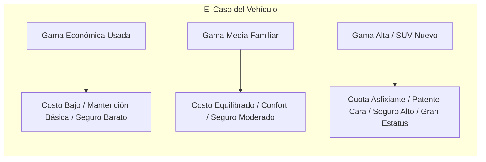

# 09. Catálogo de Eventos, Gastos, Variantes e Impacto en Bienestar

Este documento cataloga la totalidad de **Gastos (Fijos y Variables)**, **Imprevistos (Crisis)**, **Eventos de Oportunidad**, el **Sistema de Variantes (Gamas/Tiers)** y las reglas de **Impacto en Bienestar**.

---

## 1. Taxonomía de Gastos del Simulador

Los gastos se dividen en 4 categorías según su frecuencia y previsibilidad. Su activación depende de la situación del personaje (si tiene auto, si tiene hijos, si arrienda o es propietario):

### A. Gastos Fijos Mensuales (Compromisos estructurales)
*Se descuentan automáticamente cada mes según los activos y estilo de vida contratados:*

| Gasto Fijo Mensual | Condición / Activador | Impacto en Caso de No Pago |
| :--- | :--- | :--- |
| **Arriendo de Vivienda** | Si arrienda propiedad para vivir. | Aviso de desalojo / Multa contractual y -Paz Mental. |
| **Dividendo Hipotecario** | Si compró vivienda con crédito hipotecario. | Intereses penales; tras 3 meses, riesgo de ejecución hipotecaria. |
| **Cuotas de Créditos** | Si tiene crédito de consumo, automotriz o cuotas de tarjeta. | Dicom / Historial crediticio manchado; llamadas de cobranza. |
| **Alimentación y Supermercado Base** | Obligatorio para todos los personajes. | Si se reduce por debajo del mínimo, cae la Salud Física. |
| **Cuentas Fijas (Luz, Agua, Gas, Internet/Teléfono)** | Obligatorio en todo hogar. | Corte de suministro; costo de reposición (+Estrés agudo). |
| **Bencina / Combustible** | Solo si posee vehículo propio. | Vehículo inutilizable si no se carga combustible. |
| **Carga Tarjeta Bip! (Transporte público)** | Si no tiene vehículo o lo deja en casa. | Traslado diario garantizado a costo bajo y predecible. |
| **Pago de Estudios (Colegio / Universidad / Jardín)** | Si tiene hijos o si el personaje está estudiando. | Suspensión de matrícula; fuerte impacto en relaciones familiares. |

---

### B. Gastos Fijos Anuales (Previsibles con fecha fija)
*Ocurren una vez al año. El participante que tiene un Fondo de Gastos Anuales los absorbe sin enterarse; quien no, sufre el "Marzo Negro":*

| Gasto Fijo Anual | Mes Típico | Naturaleza y Mecánica |
| :--- | :--- | :--- |
| **Contribuciones de Bienes Raíces** | Abril / Junio / Sept / Nov | Pago de impuesto territorial sobre propiedades adquiridas. |
| **Patente y Permiso de Circulación** | Marzo | Obligatorio para vehículos. El valor depende de la tasación del auto. |
| **Revisión Técnica y Emisiones** | Según dígito de patente | Certificado mecánico anual obligatorio. Exige mantención previa. |
| **Pago de Impuestos (Operación Renta)** | Abril | Declaración de ingresos globales / regularización de boletas de honorarios. |

---

### C. Gastos Variables Mensuales (Estilo de Vida Cotidiano)
*Regulables mediante el tablero de estilo de vida del jugador:*
* **Salidas a Comer / Restaurantes & Bares:** Encuentros con amigos y vida social activa (+Bienestar).
* **Delivery de Comida:** Comodidad en días de cansancio; fuga silenciosa de dinero si se vuelve hábito.
* **Cine y Entretenimiento Habitual:** Salidas recreativas de fin de semana para desconexión.
* **Deporte Activo Mensual (Gym / Canchas de Pádel / Fútbol):** Mensualidad del gimnasio o arriendo semanal de canchas con amigos ($35.000 a $85.000/mes). Vital para salud y estrés.
* **Entradas a Partidos de Fútbol:** Asistencia regular a partidos del torneo local ($20.000 a $60.000/mes).

---

### D. Gastos Variables Anuales (Hitos, Cultura, Pasión y Celebraciones)
*Eventos estacionales donde la presión social y la emoción invitan al gasto:*
* **Conciertos y Festivales Masivos:** Entradas para ver a artistas favoritos (+Euforia, alto costo puntual).
* **Exposiciones, Ferias y Eventos Culturales:** Ferias del libro, muestras de arte, Comic-Con, eventos de hobbies.
* **Viajes y Vacaciones Planificadas:** El gran hito de descanso del año (Nacional o Internacional).
* **Abono Anual de Estadio / Fútbol:** Renovación de asiento anual para seguir al club toda la temporada ($180.000 a $450.000).
* **Equipamiento Deportivo Técnico:** Renovación de zapatillas running, pala de pádel o indumentaria técnica ($80.000 a $220.000).
* **Celebraciones de Cumpleaños y Aniversarios:** Festejos propios o regalos para amigos/pareja.
* **Fiestas Patrias (18 de Septiembre):** Asados, fondas, viajes y celebración típica en Chile.
* **Navidad y Fin de Año:** Compra de regalos familiares, cenas y eventos de cierre de año.
* **Compra de Ropa y Vestuario:** Renovación de temporada o compras por moda/estilo.
* **Muebles y Equipamiento Electrónico:** Mejoras de confort en el hogar (televisor, computador, sofá).

---

## 2. Catálogo de Gastos Imprevistos (Crisis y Shocks)

Aparecen en mitad de los ciclos. No se pueden ignorar; exigen una **decisión de pago inmediata**:

| Imprevisto (Crisis) | Magnitud ($ CLP) | Opciones de Resolución |
| :--- | :--- | :--- |
| **⚡ E1. Enfermedad o Urgencia Dental Severa** | $300.000 a $1.800.000 | 1. Seguro de salud / Fondo de emergencia (sin deuda). 2. Tarjeta de crédito en 6-12 cuotas (+Gasto fijo futuro). 3. Postergar con calmantes (-35% Salud y Bienestar; riesgo de duplicar costo). |
| **⚡ E2. Multa de Tránsito / Infracción de Auto** | $80.000 a $250.000 | 1. Pagar contado con descuento pronto pago. 2. Dejar pasar (acumula intereses y bloquea el permiso de circulación en marzo). |
| **⚡ E3. Pana Mecánica Mayor del Auto** | $400.000 a $2.200.000 | 1. Fondo de imprevistos previsibles. 2. Tarjeta de crédito / Crédito automotriz. 3. Dejar el auto botado y andar en micro (-Bienestar y tiempo de traslado). |
| **⚡ E4. Arreglos Críticos de la Casa (Filtración / Calefont)** | $250.000 a $900.000 | 1. Fondo de imprevistos del hogar. 2. Tarjeta comercial ferretera en cuotas. 3. Parchar con soluciones provisorias (riesgo de daño estructural mayor). |
| **⚡ E5. Electrodoméstico / Equipo de Trabajo Quemado** | $200.000 a $800.000 | 1. Reposición al contado con Fondo de Imprevistos. 2. Compra en retail en 12 o 24 cuotas con intereses. 3. Vivir sin el electrodoméstico (-Calidad de vida). |
| **⚡ E6. Viaje Imprevisto de Emergencia (Salud / Duelo)** | $250.000 a $1.200.000 | 1. Fondo de emergencias. 2. Tarjeta de crédito. 3. No asistir por falta de dinero (-Dolor emocional profundo y culpa familiar). |
| **⚡ E7. Lesión Deportiva (Pádel / Fútbol / Running)** | $180.000 a $550.000 | 1. Fondo de salud / seguro de accidentes. 2. Tarjeta de crédito para resonancia y 10 sesiones de kinesiología. 3. Reposo casero sin tratar (-40% Salud física, dolor crónico, imposibilidad de entrenar). |

---

## 3. Catálogo de Eventos Eventuales de Oportunidad (Flash Deals)

Ocasiones especiales que aparecen como una **ventana temporal de decisión**: requieren liquidez inmediata o capacidad de endeudamiento rápido:

| Evento de Oportunidad | Requisito Financiero | Dilema y Aprendizaje |
| :--- | :--- | :--- |
| **🌟 O1. Auto muy barato por apuro del dueño** | Pago 100% al contado inmediato ($3.500.000 CLP). | Solo quien tiene un **Fondo de Oportunidades ("Dry Powder")** puede aprovecharlo. Permite revenderlo con ganancia o quedarse con un gran vehículo a mitad de precio. |
| **🌟 O2. Terreno / Propiedad en remate o ganga** | Pie del 20% en efectivo + Aprobación hipotecaria rápida. | Exige tener ahorros líquidos y buen historial crediticio libre de Dicom para conseguir el crédito con el banco. |
| **🌟 O3. Curso de Capacitación de alta demanda con 80% dscto** | Matrícula de $200.000 CLP (precio real $1.000.000). | Invertir en capital humano hoy. A los 2 años desbloquea opciones de aumento de sueldo del +25%. |
| **🌟 O4. Ocasión de viaje soñado a precio regalado ("Error de tarifa")** | Pasajes y estadía por $350.000 CLP (valen $1.500.000). | ¿Tienes liquidez para comprar hoy mismo o te endeudas para no perder la oportunidad de tu vida? |
| **🌟 O5. Premio Inesperado (Sorteo / Bono extraordinario)** | Ingreso neto inmediato de $1.000.000 a $3.000.000 CLP. | La prueba de madurez: ¿Celebrar y gastarlo todo en un fin de semana, prepagar deuda cara, o alimentar fondos de reserva? |
| **🌟 O6. Inversión en Ronda Semilla de una Startup prometedora** | Ticket mínimo de $1.000.000 CLP. | Alto riesgo: 80% de probabilidad de perder todo el capital; 20% de multiplicarlo por 5 a 10 veces en el año 7. |
| **🌟 O7. Oportunidad en Inversión Inmobiliaria Fraccionada** | Cuota de entrada desde $500.000 CLP en proyecto en blanco. | Genera plusvalía y rentas futuras con ticket accesible; liquidez bloqueada por 3 años. |
| **🌟 O8. Tu equipo clasifica a la Final Internacional de Copa** | Paquete express pasaje + hotel + entrada ($850.000 CLP). | Decisión en 15 segundos: Si tienes 5 bolitas en fútbol, decir que "no" te desgarra el alma. ¿Te endeudas en 12 cuotas o lo paga tu fondo de proyectos? |
| **🌟 O9. Membresía anual de Gym / Pádel con 50% de descuento flash** | Pago único contado de $280.000 CLP (valor normal $560.000). | Oportunidad dorada para quien practica deporte: bloquea costo fijo por 1 año a precio de ganga si tiene liquidez. |
---

### 3.1 Catálogo de Ofertas Comerciales Proactivas (Tentaciones Entrantes)

En la vida real, los bancos, las tiendas y las corredoras no esperan sentados a que el cliente vaya; **llaman por teléfono o envían ofertas seductoras directamente al bolsillo del participante**, independientemente de si tiene propiedades o si las estaba buscando:

| Oferta Proactiva Entrante | Origen Comercial | La Tentación Psicológica | El Dilema y Consecuencia Real |
| :--- | :--- | :--- | :--- |
| **📞 T1. Llamada del Banco: "Crédito Pre-aprobado"** | Banco | *"Tiene disponible $6.000.000 CLP a un solo clic para lo que quiera hoy mismo."* | Falsa sensación de dinero fácil; transforma una deuda innecesaria en un compromiso fijo de -$180.000/mes a 48 meses. |
| **📞 T2. Llamada del Banco: "Aumento de Cupo de Tarjeta"** | Banco | *"Por su excelente comportamiento, duplicamos su cupo de $1.500.000 a $4.000.000."* | No es dinero regalado; eleva el riesgo de gastos impulsivos y aumenta el costo del seguro de desgravamen. |
| **🛍️ T3. En la Caja de la Tienda: "Tarjeta con Descuento Inmediato"** | Casa comercial / Retail | *"¿Desea llevar esta compra con 25% de descuento abriendo la tarjeta de la tienda ahora?"* | Aceptas por ahorrar $30.000 hoy, pero adquieres una tarjeta con costo de mantención mensual de $4.500 CLP de por vida y tasas del 38% anual. |
| **🏢 T4. Oferta de Corredora: "Departamento en Blanco con Bono Pie"** | Corredora de Propiedades | *"Invierta en un departamento sin poner pie de su bolsillo; se paga solo con el arriendo."* | Aunque no tengas propiedades, te tienta con el mito del *"arriendo garantizado"*. Si la propiedad queda desocupada (vacancia), tú debes pagar el dividendo de tu sueldo. |
| **🏢 T5. Oferta de Corredora: "Compre una Bodega o Estacionamiento"** | Corredora de Propiedades | *"Oportunidad para primerizos: adquiera un estacionamiento por $10.000.000 CLP y reciba $70.000/mes de renta."* | Entrada accesible al mundo inmobiliario sin dividendo asfixiante; requiere evaluar la demanda real del sector. |
| **🏢 T6. Oferta de Corredora: "Cámbiese a una Casa más Grande"** | Corredora de Propiedades | *"Tenemos en arriendo la casa de sus sueños en un barrio residencial."* | Apela al estatus y confort familiar; duplica el arriendo y el costo de cuentas básicas (*lifestyle creep* inducido). |
| **🏢 T7. Corredora te contacta: "¿Arrienda su Estacionamiento o Bodega?"** | Corredora de Propiedades | *"Tenemos clientes buscando arrendar su espacio desocupado en el edificio."* | Si el participante tiene bodega o estacionamiento sin usar, la corredora le ofrece administrárselo generando ingreso pasivo automático. |
| **🚗 T8. Llamada de la Automotora: "Renueve por el Modelo Nuevo con la Misma Cuota"** | Concesionaria automotriz | *"Entregue su auto actual en parte de pago y estrene el modelo del año manteniendo su cuota actual."* | La trampa de la deuda infinita: reinicia el crédito por 4 años más y aplaza el cuotón final, impidiendo que el auto sea realmente tuyo. |
| **⚽ T9. Preventa Exclusiva de Tarjeta: "Abonos y Superclásicos en 6 cuotas sin interés"** | Banco / Ticketera | *"Asegura tu entrada al clásico antes que se agoten pagando con tu tarjeta en cómodas cuotas."* | Usa la pasión futbolera para inducir endeudamiento en entretenimiento efímero que dura 90 minutos pero se paga durante 6 meses. |

---

## 4. El Sistema de Variantes y Niveles (Gamas / Tiers)

Una decisión no es binaria (*"comprar o no comprar"*). Cada oportunidad o gasto tiene **distintos niveles de sofisticación**, con impactos muy diferentes en el presupuesto y la vida:

### Ejemplo 1: Variantes al Comprar un Auto
* **Nivel 1 (Auto Usado Económico - ej. City car 2016):**
  * *Costo compra:* $4.500.000 CLP (al contado o cuota baja).
  * *Bencina:* Muy eficiente ($70.000/mes).
  * *Permiso de circulación (Marzo):* Barato ($45.000).
  * *Seguro:* Opcional o básico ($25.000/mes).
  * *Bienestar:* Cumple la función de transporte (+10% bienestar); cero presión de estatus.
* **Nivel 2 (Sedán / SUV Intermedio Semi-nuevo - ej. Modelo 2021):**
  * *Costo compra:* $11.000.000 CLP (Crédito automotriz cuota $260.000/mes).
  * *Bencina:* Moderada ($130.000/mes).
  * *Permiso de circulación (Marzo):* $140.000.
  * *Seguro:* $55.000/mes.
  * *Bienestar:* Alto confort y seguridad familiar (+20% bienestar).
* **Nivel 3 (SUV de Alta Gama / Nuevo 0 km - ej. Modelo del año):**
  * *Costo compra:* $24.000.000 CLP (Crédito Inteligente: cuota $480.000/mes + cuotón final de $10.000.000).
  * *Bencina:* Alta cilindrada ($220.000/mes).
  * *Permiso de circulación (Marzo):* $450.000 (¡golpe brutal!).
  * *Seguro obligatorio todo riesgo:* $110.000/mes.
  * *Bienestar:* Euforia inicial (+35% estatus), pero genera un compromiso fijo que devora el 45% del sueldo todos los meses.

### Ejemplo 2: Variantes al Salir de Vacaciones
* **Nivel 1 (Descanso local / Camping / Casa familiar):** Costo $200.000 CLP. Desconexión tranquila, cero deuda.
* **Nivel 2 (Hotel / Cabaña en el sur o norte de Chile):** Costo $800.000 CLP. Gran experiencia familiar; requiere ahorro de 6 meses.
* **Nivel 3 (Viaje Internacional a Europa / Caribe all-inclusive):** Costo $2.800.000 CLP. Experiencia cumbre (+40% bienestar), pero si se financia en cuotas, ata el presupuesto por los siguientes 2 años.

---

## 5. Reglas de Modificación del Bienestar: El Sistema de Ponderación por Personalidad

El impacto de un evento o decisión en la **Paz Mental** y la **Calidad de Vida** **no es plano ni universal**. Depende de la **huella psicológica y actitudinal** del personaje. Lo que para un participante es un detalle insignificante, para otro es una tragedia emocional.

### Los 4 Multiplicadores Emocionales de Personalidad

Cada personaje tiene 4 coeficientes de sensibilidad (que van desde **0.5x = Baja sensibilidad** hasta **2.0x = Alta sensibilidad / Punto ciego**):

1. **$W_{ans}$ (Sensibilidad a la Deuda / Ansiedad Financiera):**
   * *Mide:* Cuánto le angustia deber dinero, tener cuotas pendientes o ver la cuenta vacía.
   * *Multiplicador:* Para un personaje ansioso ($W_{ans} = 1.8x$), una deuda de tarjeta destruye su paz mental el doble de rápido que para un despreocupado ($W_{ans} = 0.6x$).
2. **$W_{soc}$ (Sensibilidad Social / FOMO / Estatus):**
   * *Mide:* Cuánto necesita la validación del entorno y cuánto le duele quedarse fuera de planes grupales.
   * *Multiplicador:* Para un personaje sociable/orientado a estatus ($W_{soc} = 2.0x$), renunciar a un viaje o boda por no tener dinero provoca una caída brutal de felicidad (-40%); para un austero/introvertido ($W_{soc} = 0.5x$), apenas le afecta (-5%).
3. **$W_{hed}$ (Orientación Hedonista / YOLO):**
   * *Mide:* La importancia de la gratificación presente y la baja tolerancia a la privación.
   * *Multiplicador:* Disfruta intensamente salir a comer o viajar (+Bienestar amplificado), pero sufre un desgaste emocional profundo si se le obliga a vivir en austeridad estricta.
4. **$W_{seg}$ (Apego a la Seguridad y Certeza):**
   * *Mide:* La necesidad de tener el futuro bajo control y la aversión al riesgo.
   * *Multiplicador:* Tener un Fondo de Emergencia lleno le genera un alivio y orgullo inmenso (+Paz Mental x 1.8); sufrir volatilidad en inversiones o un imprevisto sin seguro le causa pánico real.

---

### Fórmula de Impacto en los Medidores

$$\Delta \text{Paz Mental} = \text{Impacto Base} \times W_{ans} \quad (\text{si hay deuda o incertidumbre}) \quad \text{ó} \quad \times W_{seg} \quad (\text{si hay ahorro seguro o imprevisto})$$
$$\Delta \text{Calidad de Vida} = \text{Impacto Base} \times W_{soc} \quad (\text{en eventos sociales/estatus}) \quad \text{ó} \quad \times W_{hed} \quad (\text{en placer/privación})$$

---

### Comparativa: El Mismo Evento en Dos Personajes Opuestos

| Situación Vivida | Reacción de "El Guardián Ansioso" ($W_{ans}=1.8, W_{seg}=1.7, W_{soc}=0.6$) | Reacción de "El Hedonista Social" ($W_{ans}=0.5, W_{hed}=1.9, W_{soc}=2.0$) |
| :--- | :--- | :--- |
| **Quedar debiendo $1.000.000 en tarjeta de crédito** | **-35% Paz Mental.** Sufre insomnio, siente que perdió el control de su vida y se autoimpone un castigo de privación. | **-8% Paz Mental.** *"Ya saldrá algo el próximo mes"*. Casi no siente el peso de la deuda mientras pueda seguir saliendo. |
| **Tener que renunciar a un viaje soñado con amigos por falta de dinero** | **-5% Calidad de Vida.** Se queda tranquilo en casa sabiendo que protegió sus ahorros; no le da mayor importancia social. | **-45% Calidad de Vida.** Depresión, sensación de aislamiento, vergüenza ante sus amigos y frustración extrema. |
| **Tener $4.000.000 en un Depósito a Plazo al 4.5%** | **+25% Paz Mental.** Siente un escudo impenetrable. Duerme feliz sabiendo que tiene respaldo. | **-10% Paz Mental.** Siente frustración y aburrimiento por tener el dinero "estancado sin hacer nada". |
| **Comprar un auto de lujo 0 km con cuotón final** | **+5% Bienestar, -30% Paz Mental.** La culpa por el gasto y el terror a la cuota mensual superan el placer del auto. | **+40% Bienestar.** Siente que *"llegó a la cima"*; presume el auto con sus amigos y su autoestima se dispara. |

---

### Matriz Base de Reacción ante Eventos

| Forma de Actuar ante el Evento | Impacto en 💰 Salud Financiera | Impacto en 🧠 Paz Mental (Base) | Impacto en 🌟 Calidad de Vida (Base) | Ponderador que Modula el Resultado |
| :--- | :--- | :--- | :--- | :--- |
| **A. Pagar con Fondo de Reserva Específico** | Disminuye liquidez del fondo; **cero deuda**. | **+15% Paz Mental** (alivio de estar preparado). | Se mantiene intacta. | Modulado por $W_{seg}$ (más alivio a quien más valora la certeza). |
| **B. Pagar con Tarjeta de Crédito (Cuotas)** | Aumenta el pasivo; crea un **nuevo gasto fijo mensual**. | **-15% a -25% Paz Mental** (carga de cuotas). | Resuelve la urgencia (+10% temporal). | Modulado por $W_{ans}$ (golpea fuertísimo al personaje ansioso). |
| **C. Pagar el "Mínimo" de la Tarjeta** | **Bomba de tiempo:** capitalización de intereses al 35-40% anual. | **-30% Paz Mental** (angustia de bola de nieve). | Alivio momentáneo engañoso. | Modulado por $W_{ans}$ (puede llevar a *burnout* financiero). |
| **D. Postergar / Renunciar por Falta de Fondos** | El dinero queda intacto hoy. | **-20% Paz Mental** (miedo a que empeore). | **-30% a -40% Calidad de Vida** (pérdida o vergüenza). | Modulado por $W_{soc}$ y $W_{hed}$ (destroza al personaje social/hedonista). |
| **E. Aprovechar Oportunidad con Ahorro Líquido** | Transforma liquidez en un activo valioso (inversión o capacitación). | **+15% Paz Mental** (sensación de avance). | **+25% Calidad de Vida** (autorrealización y gozo). | Modulado por $W_{hed}$ y $W_{seg}$ (genera orgullo y disfrute duradero). |
