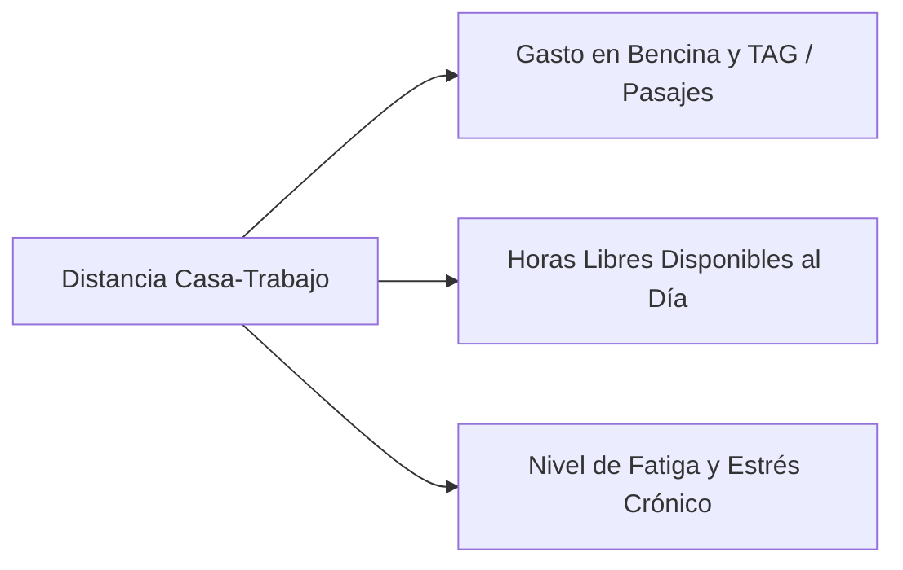

# 10. Factores Estructurales del Personaje: Vivienda, Vehículo, Distancia, Vecindario y Trabajo

La situación financiera de un personaje no depende solo de su sueldo bruto y su fuerza de voluntad. Está condicionada por **5 anclas estructurales del entorno** que determinan sus costos fijos automáticos, su nivel de desgaste diario y su capacidad de maniobra frente a crisis.

> [!NOTE]
> **Diferencia entre Plan General y Taller Puntual:**  
> Este documento profundiza en las 5 anclas estructurales del **Plan Amplio General**. En el **Taller Puntual** implementado en la app web (`index.html`), estas anclas se sintetizan de forma interactiva en la pantalla de **Decisiones Iniciales (Vivienda, Trabajo y Transporte)** con 4 opciones elegibles en cuadrícula responsiva por cada categoría (ver [16. Modo Taller](16_modo_taller_y_panel_facilitador.md) y [18. Diagramación de Pantalla](18_diagramacion_y_distribucion_de_pantalla.md)).

---

## 1. Tipo de Vivienda y sus Costos de Mantención

El tipo de inmueble donde habita el personaje no solo define el arriendo o dividendo, sino una cascada de gastos indirectos:

| Tipo de Vivienda | Costo Base Referencial | Gastos Comunes / Mantención Mensual | Mantención Periódica e Imprevistos | Climatización / Cuentas |
| :--- | :--- | :--- | :--- | :--- |
| **🏠 V1. Pieza / Estudio Pequeño (1 Amb)** | Arriendo $250.000 a $380.000 | Muy bajos ($15.000 a $30.000) | Mínima; reparaciones a cargo del arrendador. | Mínimo consumo de luz y calefacción. |
| **🏢 V2. Departamento Tradicional (2D-1B / 2D-2B)** | Arriendo/Dividendo $450.000 a $700.000 | Medios ($60.000 a $120.000 con conserjería y ascensor) | Mantención moderada (calefont, griferías, sellos). | Consumo eléctrico y de agua promedio. |
| **🏊 V3. Departamento en Condominio Resort** | Arriendo/Dividendo $750.000 a $1.200.000 | Elevados ($150.000 a $280.000 por piscina, gimnasio, jardines) | Mantención media-alta; cuotas extraordinarias de comunidad. | Cuentas altas por áreas comunes y climatización. |
| **🏡 V4. Casa Pareada de Barrio** | Arriendo/Dividendo $500.000 a $850.000 | Nulos o mínimos de junta de vecinos ($5.000 a $15.000) | Requiere mantención propia regular (techumbre, pintura exterior, rejas). | Gasto medio-alto en gas/leña en invierno. |
| **🏰 V5. Casa Grande con Patio y Jardín** | Arriendo/Dividendo $1.100.000 a $2.000.000 | Bajos o nulos si es abierta; altos si es condominio ($100.000+) | **Mantención muy cara:** jardinero, bombas de agua, pintura de fachada, goteras, contribuciones altas. | Alto costo de calefacción en invierno y riego en verano. |

> **Impacto Pedagógico:** Vivir en una casa grande o en un condominio con piscina añade entre $150.000 y $350.000 CLP de gastos fijos mensuales invisibles que no se van en amortizar deuda, sino en mera mantención.

---

## 2. Tipo de Vehículo y sus Costos Asociados

El vehículo es uno de los mayores drenajes de capital del hogar. A mayor sofisticación del vehículo, mayor es el costo por kilómetro recorrido:

| Tipo de Vehículo | Bencina / Combustible Mes | Seguro Automotriz | Patente / Permiso (Marzo) | Mantención Programada (cada 10.000 km) | Falla Imprevista Típica |
| :--- | :--- | :--- | :--- | :--- | :--- |
| **🚶 A0. Sin Vehículo (Solo Bip! / Metro)** | $0 (Bip: $45.000 fijo) | $0 | $0 | $0 | Cero riesgo mecánico. |
| **🛵 A1. Moto / Scooter Urbano** | Muy bajo ($35.000) | Opcional ($20.000) | Muy barata ($30.000) | Económica ($40.000) | Pinchazo o batería ($50.000). |
| **🚗 A2. Auto Usado Económico (City Car)** | Bajo ($75.000) | Básico ($28.000) | Barata ($45.000) | Taller de barrio ($80.000) | Alternador o frenos ($150.000). |
| **🚙 A3. Sedán / SUV Intermedio Familiar** | Medio ($140.000) | Completo ($55.000) | Media ($140.000) | Taller autorizado ($160.000) | Amortiguadores o embrague ($450.000). |
| **🏎️ A4. SUV de Alta Gama / Nuevo 0 km** | Alto ($230.000) | Todo riesgo ($110.000) | **Carísima ($420.000+)** | Concesionario oficial ($380.000+) | Sensores, turbo o caja electrónica ($1.800.000+). |

---

## 3. Distancia entre Casa y Trabajo (El Factor Traslado)

El tiempo y la distancia del trayecto diario impactan directamente en la billetera y en el desgaste biológico del participante:

* **D1. Cerca (< 15 minutos / Caminando o Bici):**
  * *Costo financiero:* Casi $0.
  * *Impacto en Bienestar:* **+25% Paz Mental y Energía**. 2 horas extra al día de tiempo libre para cocinar en casa (ahorro en comida), hacer deporte o descansar.
* **D2. Distancia Media (30 a 45 minutos en Metro o Auto sin autopista):**
  * *Costo financiero:* Bip estándar ($45.000/mes) o combustible moderado ($90.000/mes).
  * *Impacto en Bienestar:* Nivel de estrés manejable; tiempo de lectura o podcasts.
* **D3. Lejos con Autopistas Urbanas / TAG (> 60-90 minutos cada viaje):**
  * *Costo financiero:* Disparo de combustible + **Cuenta de TAG/Peajes ($80.000 a $160.000 CLP/mes solo en autopistas)**.
  * *Impacto en Bienestar:* **-30% Paz Mental y Salud**. Pérdida de 3 horas diarias en tacos o transporte colapsado. Cansancio crónico que detona compras de comida rápida y delivery por no tener energía para cocinar.

---

## 4. Vecindario y su Influencia en el Costo de Alimentos y Servicios

El entorno geográfico donde reside el personaje fija el "precio base" de la vida cotidiana:

| Tipo de Vecindario | Acceso Comercial Típico | Canasta de Alimentos (Supermercado / Feria) | Servicios y Ocio Local (Cafés, Farmacias) |
| :--- | :--- | :--- | :--- |
| **🛒 B1. Barrio Popular / Tradicional con Feria Libre** | Ferias libres semanales, almacenes de barrio, panaderías locales y mayoristas. | **Canasta Económica (-25%):** Frutas, verduras y abarrotes comprados a precio de feria. Gran ahorro familiar. | Menos tentaciones de cadenas caras; servicios locales a precios razonables. |
| **🏙️ B2. Barrio Céntrico / Mixto** | Supermercados de cadena express, minimarkets y aplicaciones de delivery. | **Canasta Media Estándar:** Acceso a ofertas de grandes cadenas, pero alta exposición a compras rápidas de paso. | Restaurantes y cafés de paso moderados. |
| **🌳 B3. Barrio Exclusivo / Sector Oriente** | Supermercados premium (Jumbo, tiendas gourmet), cafeterías de especialidad, restaurantes caros. | **Canasta Premium (+30%):** Todo el entorno de compras es más costoso; ausencia de ferias libres cercanas. | Alto gasto social por presión del entorno: cafés de $4.500, salidas locales caras. |

---

## 5. Tipo de Trabajo y Estructura de Ingresos

No todos los sueldos se comportan igual ante una crisis. La modalidad laboral determina la estabilidad, los beneficios y el techo de crecimiento:

| Modalidad Laboral | Rango de Sueldo Neto | Estabilidad / Riesgo de Despido | Beneficios Extra | Comportamiento en Crisis |
| :--- | :--- | :--- | :--- | :--- |
| **👔 T1. Empleado Corporativo (Contrato Indefinido)** | $1.600.000 a $2.800.000 | Media-Alta; indemnización por años de servicio en caso de despido. | Seguro complementario de salud, aguinaldos, bono anual por desempeño. | Amortigua crisis de salud gracias a seguros de empresa; vulnerable a reestructuraciones corporativas. |
| **🏛️ T2. Funcionario Público / Empleo Institucional** | $1.200.000 a $1.900.000 | **Máxima estabilidad:** riesgo de despido casi nulo; sueldos reajustados por IPC. | Caja de compensación, convenios médicos, estabilidad predecible. | Ingresos asegurados en recesiones; techo salarial más rígido ante oportunidades rápidas. |
| **💻 T3. Profesional Independiente / Honorarios (Freelance)** | Muy variable ($700.000 en meses malos a $3.500.000 en meses pico) | Sin estabilidad; depende de clientes mes a mes. Retención de impuestos del 13.75%. | Cero beneficios de empresa; debe pagar sus propias cotizaciones y salud privada. | **Vulnerabilidad extrema sin Fondo de Reserva:** un mes de vacas flacas obliga a endeudarse si no guardó en los meses buenos. |
| **🏪 T4. Empleado Comercial / Retail con Comisiones** | $850.000 (base) + $200.000 a $800.000 (comisión) | Media; alta rotación si caen las metas de venta. | Seguro básico de salud (Fonasa/Isapre base), descuentos en compras de la tienda. | En recesiones comerciales el sueldo cae a su piso mínimo, asfixiando los compromisos fijos. |

---

## 6. Matriz de Combinatorias: La Trampa de los Costos Fijos

La interacción de estos 5 factores explica por qué personas con el mismo sueldo terminan en situaciones radicalmente opuestas:

* **Escenario "La Trampa Dorada":**
  * *Personaje:* Gana $2.400.000 CLP.
  * *Configuración:* Casa grande en condominio (**V5**) + SUV nuevo 0 km (**A4**) + Vive lejos con TAG (**D3**) + Vecindario exclusivo (**B3**).
  * *Resultado:* Sus compromisos fijos obligatorios devoran **$2.250.000 CLP/mes**. Le sobran apenas $150.000. Al primer imprevisto de salud o mecánica, cae en deuda de tarjeta de crédito a pesar de ser de "altos ingresos".
* **Escenario "El Antifrágil Ágil":**
  * *Personaje:* Gana $1.500.000 CLP (mucho menos que el anterior).
  * *Configuración:* Departamento 2D bien ubicado (**V2**) + Auto económico usado (**A2**) o metro + Cerca del trabajo (**D1**) + Barrio tradicional con feria (**B1**).
  * *Resultado:* Sus compromisos fijos son de solo **$850.000 CLP/mes**. Le sobran **+$650.000 CLP libres cada mes** para alimentar sus fondos de reserva, invertir en Cuenta 2 y vivir sin estrés de deudas.
