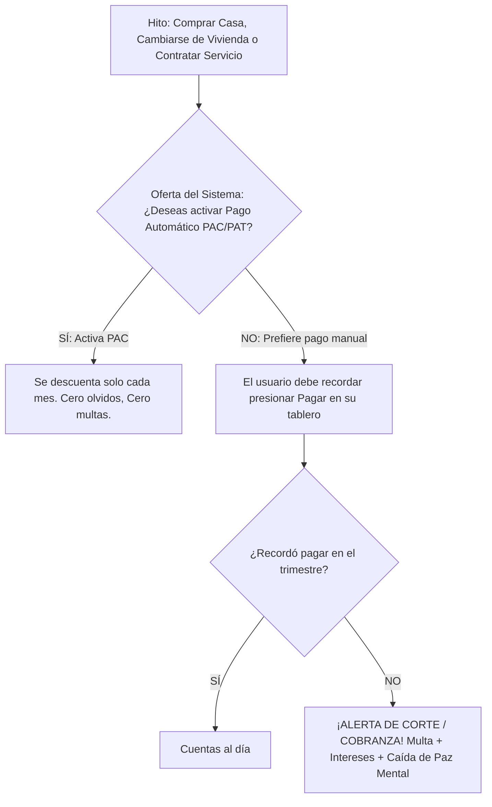
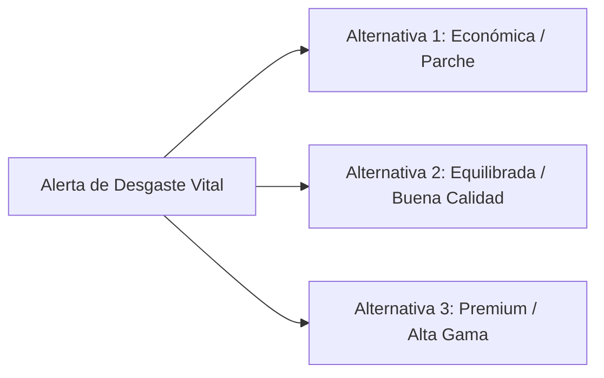

# 11. Sistema de Atención, Carga Mental, Olvidos y Automatización

> *"En las finanzas personales, las personas no solo quiebran por falta de dinero; quiebran por desorden administrativo, olvidos y falta de automatización."*

Este documento formaliza la mecánica de **Carga Mental, Notificaciones de Mora, Riesgo de Quedar Botado** y el **Dilema Calidad vs. Precio** en compras y reparaciones.

---

## 1. La Filosofía: Proactividad vs. El Dolor del Olvido

Para que el simulador sea un verdadero espejo de la realidad, **el sistema no actúa como una "mamá financiera" que te recuerda pagar cada cuenta a tiempo**. 

* **Regla de Oro:** El sistema **NO** te envía recordatorios previos de vencimiento de cuentas (luz, agua, arriendo, dividendo, cuotas de crédito).
* **La Notificación de Realidad:** El sistema solo te notifica **cuando ya te atrasaste** y la empresa de servicios, el dueño del inmueble o el banco te aplican la sanción:
  * *Llamada de cobranza extrajudicial.*
  * *Cobro de intereses penales y gastos de cobranza.*
  * *Corte de suministro (luz/agua/internet) con cobro obligatorio de reposición.*
  * *Aviso de desalojo o reporte negativo en Dicom.*

---

## 2. La Mecánica de Automatización (PAC / PAT)

Para resolver este desafío, el simulador introduce una de las herramientas más poderosas de la educación financiera moderna: **El Pago Automático de Cuentas (PAC con cargo a cuenta corriente o PAT con cargo a tarjeta de crédito)**.

### Reglas del PAC / PAT en el Simulador:
1. **Oferta en el Momento del Hito:** Al comprar una vivienda (dividendo), cambiarse de casa (arriendo y cuentas) o contratar internet/seguros, el sistema pregunta:
   * *`[ ] Activar Pago Automático (PAC) mensual.`*
2. **El Beneficio del PAC:** Elimina el 100% de la carga mental. Nunca sufrirás cortes ni multas por olvido.
3. **El Riesgo del PAC:** Requiere tener **saldo suficiente en la cuenta corriente**. Si llega el día del cargo y la cuenta está en cero, el PAC rebota y el banco cobra una comisión por fondos insuficientes o sobregiro.
4. **Si el usuario rechaza el PAC:** En su tablero de control mensual tendrá el botón manual **"Pagar Cuentas del Mes"**. Si deja pasar el trimestre concentrado en otras cosas y no lo presionó, la simulación detona el evento de cobranza.

---

## 3. El Vehículo y el Combustible: El Riesgo de Quedar Botado

Siguiendo la misma lógica de realismo:
* El sistema **NO** avisa *"Te queda 1/4 de estanque de bencina"*.
* Si el participante tiene vehículo pero no asignó el ítem de combustible en su mes/trimestre, al iniciar un desplazamiento la simulación arroja la alerta:

> ⛽ **¡AUTO SIN COMBUSTIBLE EN MITAD DE LA CALLE!**
> *"Tu vehículo se detuvo por falta de bencina. Tienes que llegar urgente a tu trabajo o compromiso."*
>
> **Opciones de Emergencia (Decisión Rápida):**
> 1. **Auto de Aplicación (Uber / Cabify) con Tarifa Dinámica:** Costo $18.000 CLP. Llegas a tiempo, pero pagas un sobreprecio severo.
> 2. **Taxi Tradicional en la calle:** Costo $12.000 CLP al contado.
> 3. **Locomoción Colectiva (Metro / Micro):** *Solo disponible si tu Tarjeta Bip! tiene saldo cargado.* Costo $850 CLP, pero llegas 45 minutos tarde (**-15% Paz Mental por estrés laboral**).
> 4. **Llamar grúa y comprar bidón de bencina:** Costo $60.000 CLP para rescatar el auto.

---

## 4. Avisos del Sistema: Desgaste Natural y Deterioro Vital

El sistema **SÍ te avisará** cuando los activos físicos de la vida se desgastan o cuando las necesidades biológicas exigen compras. Cuando esto ocurre, no hay una opción única: el juego ofrece **2 o 3 alternativas basadas en el dilema Calidad vs. Precio**:

### Catálogo de Avisos de Deterioro y sus 3 Alternativas:

| Desgaste / Necesidad Vital | Alternativa 1: Económica / Parche | Alternativa 2: Equilibrada (Precio/Calidad) | Alternativa 3: Premium / Larga Duración |
| :--- | :--- | :--- | :--- |
| **🏠 D1. Deterioro de Casa: Filtración en el Techo / Goteras** | **Arreglo con sellador parche ($80.000):** Barato hoy, pero dura 6 meses y arriesga daño mayor en invierno. | **Reparación profesional de techumbre ($320.000):** Trabajo garantizado por 3 años; gasto planificado. | **Renovación completa de cubierta y aislamiento ($850.000):** Trabajo definitivo (+Valor de la propiedad, +Ahorro de gas en calefacción). |
| **👕 D2. Renovación de Ropa y Vestuario de Trabajo** | **Ropa básica en liquidación ($50.000):** Resuelve el mes; telas sintéticas de poco confort y desgaste rápido. | **Vestuario de marcas intermedias ($160.000):** Buena presentación profesional y durabilidad equilibrada. | **Marcas exclusivas / Ropa a medida ($420.000):** Gran estatus y autoestima (+20% bienestar), pero alto costo. |
| **📺 D3. Refrigerador o Lavadora Murió (Línea Blanca)** | **Comprar usado en internet ($120.000):** Sin garantía; riesgo de volver a fallar en 1 año. | **Comprar nuevo eficiente en retail ($380.000):** Garantía de 2 años, bajo consumo eléctrico. | **Línea premium inverter inteligente ($890.000):** Máxima durabilidad, conectividad wifi y ahorro extremo de energía. |
| **🛒 D4. Despensa Vacía (Alimentación Familiar)** | **Alimentos procesados y carbohidratos baratos ($120.000/mes):** Llena el estómago, pero deteriora la Salud Física con el tiempo. | **Canasta equilibrada en feria y supermercado ($260.000/mes):** Frutas, verduras y proteínas balanceadas. | **Alimentación 100% orgánica / Gourmet ($520.000/mes):** Máxima vitalidad y salud física, pero gasto muy abultado. |

---

## 5. La Gran Lección Vivencial: Equilibrio y Autonomía

Con estas mecánicas, el participante descubre en carne propia:
1. **Que la pereza administrativa sale cara:** Quien no automatiza sus pagos termina pagando entre un 10% y un 25% más en multas e intereses por puros despistes.
2. **La trampa de "lo barato cuesta caro":** Elegir siempre la Alternativa Económica (el parche) hace que la casa y el auto se rompan el triple de veces, gastando más dinero al cabo de 8 años que quien invirtió en calidad equilibrada desde el inicio.
3. **El verdadero valor del dinero:** El dinero no es para acumularlo en una bóveda, es para comprar **tiempo libre, automatización y herramientas de calidad** que te quiten problemas de la cabeza.
