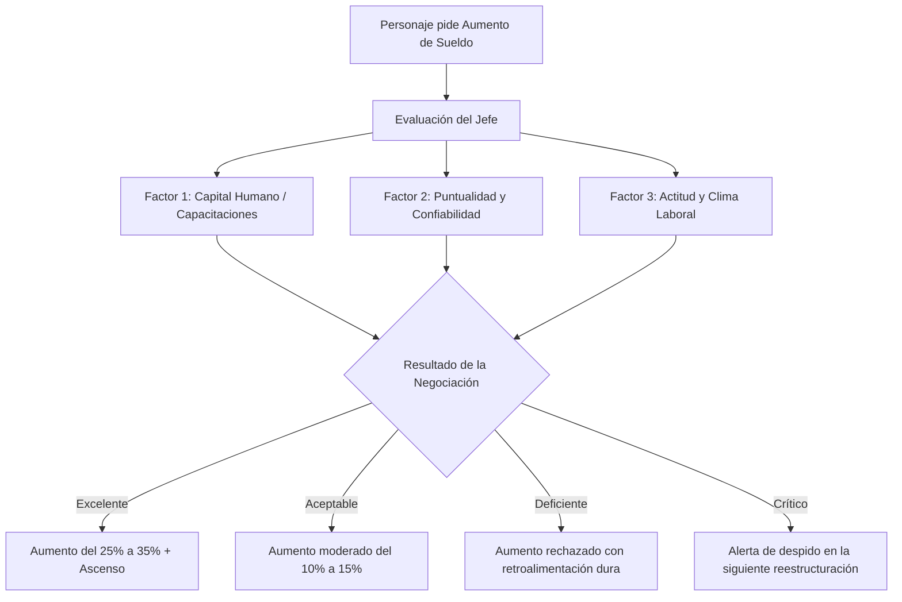

# 12. Mecánica de Negociación Laboral y Evaluación de Aumento de Sueldo

Cuando el personaje visita el **Lugar de Trabajo (W2: Pedir un Aumento de Sueldo)**, la respuesta de la jefatura no es un lanzamiento de dados al azar. Representa una **evaluación holística de desempeño y clima laboral** basada en 3 factores clave:

---

## 1. Los 3 Factores Evaluados por la Jefatura

### Factor 1: Capital Humano y Capacitación Acreditada (Peso: 40%)
* **¿Qué evalúa el jefe?** Si el empleado ha invertido tiempo y recursos en mejorar sus competencias profesionales (**Acción W1 del catálogo de oportunidades**): cursos técnicos, diplomados, certificaciones o posgrados.
* **Mecánica:**
  * *Sin capacitaciones previas:* 0 puntos. El jefe percibe que el empleado hace "solo lo justo" y sus habilidades están estancadas.
  * *Con 1 capacitación relevante:* +20 puntos. Se valora el esfuerzo y la actualización técnica.
  * *Con 2 o más capacitaciones:* +40 puntos (Puntaje máximo). El empleado demuestra liderazgo, valor añadido y justificación técnica para una nueva escala salarial.

---

### Factor 2: Puntualidad, Confiabilidad y Fatiga de Traslado (Peso: 30%)
* **¿Qué evalúa el jefe?** La asistencia puntual, la disponibilidad y la energía con la que llega a trabajar.
* **Mecánica (Conectada a la Distancia Casa-Trabajo y Transporte):**
  * *Vive Cerca (D1 - <15 min):* +30 puntos. Llega fresco, puntual, con energía alta y disponibilidad ante emergencias de la empresa.
  * *Distancia Media (D2 - 30-45 min):* +20 puntos. Cumplimiento normal; retrasos ocasionales menores.
  * *Vive Lejos con Autopistas/TAG (D3 - >60-90 min):*
    * Si no tiene auto y usa micro colapsada: Sufre penalización por retrasos recurrentes.
    * Si tuvo episodios de **"Auto sin combustible en plena calle"** o fallas mecánicas sin fondo de reserva: el jefe registra las ausencias imprevistas.
    * *Puntaje:* 0 a 10 puntos. El jefe comenta: *"Notamos que el viaje te desgasta mucho y los retrasos están afectando las reuniones de la mañana"*.

---

### Factor 3: Estado de Ánimo, Actitud y Clima Laboral (Peso: 30%)
* **¿Qué evalúa el jefe?** La energía vital, la disposición constructiva, la resiliencia y el impacto del empleado en el ambiente de su equipo.
* **Mecánica (Conectada a los Medidores de Paz Mental y Bienestar):**
  * *Bienestar y Paz Mental > 70%:* +30 puntos. El empleado proyecta calma, entusiasmo, buena comunicación, escucha activa y liderazgo positivo.
  * *Bienestar y Paz Mental entre 40% y 69%:* +15 puntos. Desempeño profesional neutro, sin sobresaltos.
  * *Bienestar y Paz Mental < 40% (Empleado estresado / endeudado / al borde del burnout):* 0 puntos.
    * **La Realidad Psicológica:** Una persona consumida por llamadas de cobranza, deudas de tarjeta de crédito o frustración por privaciones severas proyecta irritabilidad, cansancio, quejas constantes y negatividad en el equipo.
    * *El comentario del jefe:* *"Te vemos muy sobrepasado y distante últimamente. Necesitamos que recuperes tu energía antes de asumir mayores responsabilidades"*.

---

## 2. Matriz de Resultados de la Negociación Salarial

$$\text{Puntaje Total} = \text{Puntaje Capacitación} + \text{Puntaje Puntualidad} + \text{Puntaje Clima Laboral} \quad (0 \text{ a } 100 \text{ pts})$$

| Rango de Puntaje | Veredicto del Jefe | Impacto en el Sueldo | Impacto en Bienestar | Diálogo Típico del Jefe |
| :---: | :--- | :---: | :---: | :--- |
| **80 a 100 pts** | **Promoción y Gran Aumento** | **+25% a +35%** en sueldo neto mensual de forma permanente. | **+30% Calidad de Vida**, **+20% Paz Mental**. | *"Nos impresiona tu preparación y tu actitud positiva con el equipo. Eres un pilar para el área. Aprobamos un aumento del 30% y un nuevo cargo."* |
| **55 a 79 pts** | **Aumento Moderado por Mérito** | **+10% a +15%** en sueldo neto mensual. | **+15% Paz Mental**, **+10% Calidad de Vida**. | *"Reconocemos tu esfuerzo y tu buen trabajo. La empresa aprueba un ajuste del 12% para este año."* |
| **35 a 54 pts** | **Aumento Congelado (En Observación)** | **0%** (Sueldo se mantiene igual). | **-15% Paz Mental** (frustración por el rechazo). | *"Por ahora no es viable. Necesitamos que mejores tu puntualidad y te sugerimos capacitarte en las nuevas herramientas del área."* |
| **0 a 34 pts** | **Rechazo Crítico y Advertencia Laboral** | **0%** + Se activa riesgo de despido en la siguiente crisis (**E2**). | **-30% Paz Mental**, **-20% Calidad de Vida** (alarma). | *"Tu rendimiento y tu actitud negativa están perjudicando al equipo. En lugar de un aumento, necesitamos evaluar seriamente tu continuidad."* |

---

## 3. El Gran Aprendizaje Pedagógico

Con esta mecánica, los participantes descubren en carne propia:
1. **Que el trabajo no premia solo "estar sentado":** Pedir aumento sin haberse capacitado suele chocar contra un muro.
2. **Que vivir lejos tiene un costo laboral invisible:** Elegir una casa más grande en la periferia a costa de 2 horas de taco diario no solo cuesta bencina y TAG; daña la puntualidad y la energía que te permitirían ascender en tu carrera.
3. **Que las deudas se notan en el rostro:** Estar asfixiado por deudas destruye el estado de ánimo, lo que te hace ver amargado o desconcentrado ante tus superiores, cerrándote las puertas a ganar más dinero.
