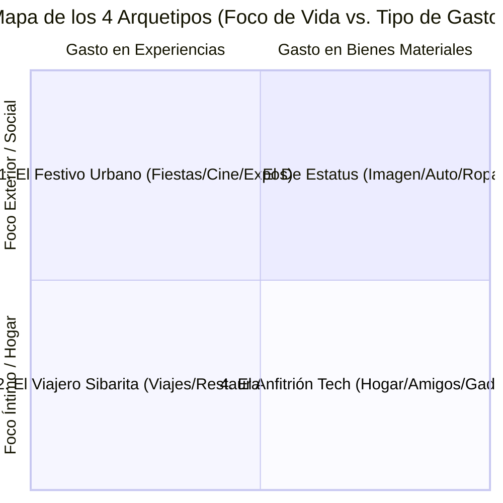

# 15. Los 4 Arquetipos Psicológicos Equilibrados

Para que la experiencia del taller sea nítida, fácil de comprender y altamente competitiva y comparable entre los 20 participantes, el juego se estructura en torno a **4 Personalidades Básicas y Equilibradas**. 

Cada arquetipo obtiene su **Bienestar y Calidad de Vida** de una fuente psicológica distinta, posee un **patrón de gasto diferente**, y tiene **puntos ciegos y vulnerabilidades equivalentes** para que ninguno tenga una ventaja injusta.

> [!NOTE]
> **Diferencia entre Plan General y Taller Puntual:**  
> Los 4 arquetipos psicológicos equilibrados (*El Festivo Urbano*, *El Viajero Sibarita*, *El De Estatus* y *El Anfitrión Tech*) pertenecen a la arquitectura teórica del **Plan Amplio General**. En el **Taller Puntual** implementado en la aplicación web (`index.html`), se **eliminó la selección de perfiles predeterminados** para que cada asistente cree su propia identidad única y directa mediante sus **Intereses Personales** (20 bolitas) y sus **Decisiones Iniciales** (Vivienda, Trabajo y Transporte con 4 opciones) antes de revisar su ficha resumen (ver [16. Modo Taller y Panel del Facilitador](16_modo_taller_y_panel_facilitador.md)).

---

## 1. Los 4 Perfiles Psico-Financieros

---

### 🎭 1. El Festivo Urbano (Cultura, Celebraciones y Carrete)
* **Avatar:** 🎪 / 🎟️
* **Fuente de Bienestar:** Salir a pasarlo bien, cine, celebraciones de cumpleaños, ferias temáticas, exposiciones culturales y eventos sociales.
* **Patrón de Gasto:** **Gastos medianos de alta frecuencia (Gasto Hormiga Social).**
  * Salidas de fin de semana, entradas a eventos, regalos de cumpleaños, taxis de regreso.
* **Punto Ciego Financiero:** Falsa ilusión de no gastar mucho (*"fueron solo $25.000 aquí y $30.000 allá"*), pero la suma mensual acumulada se traga el 35% de su sueldo sin dejar rastro visible.
* **Detonante de Frustración:** Quedarse encerrado el fin de semana o tener que decir que no a la fiesta de un amigo por no tener saldo (-Paz Mental por aislamiento).
* **Cómo Satisfacerlo con Éxito:** Establecer un **presupuesto semanal estricto de salidas en efectivo/débito** y no usar la tarjeta de crédito para pagar carretes ni entradas.

---

### ✈️ 2. El Viajero Sibarita (Mundo y Gastronomía)
* **Avatar:** 🌍 / 🍽️
* **Fuente de Bienestar:** Conocer nuevos destinos (vacaciones en el sur/norte de Chile, viajes internacionales) y el placer de comer rico en restaurantes y cafeterías de autor.
* **Patrón de Gasto:** **Gastos esporádicos muy altos + Gastos gastronómicos recurrentes.**
  * Compras súbitas de pasajes y hoteles ($600.000 a $2.000.000) más cuentas de restaurantes de $40.000 a $80.000.
* **Punto Ciego Financiero:** Desvío de fondos. Utiliza el dinero del Fondo de Emergencias para comprar pasajes en oferta ("error de tarifa") creyendo que *"ya repondrá el dinero más adelante"*.
* **Detonante de Frustración:** Pasar un año entero comiendo arroz con fideos en casa sin salir de la ciudad (-30% Calidad de Vida por monotonía).
* **Cómo Satisfacerlo con Éxito:** Crear un **Fondo de Viajes y Gastronomía separado (con ahorro mensual programado)**, de modo que cada viaje o cena esté pagado antes de sentarse a la mesa.

---

### 👔 3. El De Estatus (Imagen, Auto y Moda)
* **Avatar:** 🏎️ / 👔
* **Fuente de Bienestar:** Sentir el reconocimiento de sus pares, proyectar éxito profesional y vestir bien. Valora tener un auto nuevo e impecable, vivir en un buen barrio y usar ropa de marca.
* **Patrón de Gasto:** **Gastos fijos estructurales muy altos y de largo plazo.**
  * Cuota mensual del auto (Crédito Inteligente), arriendo/dividendo en sector visible, seguro automotriz caro, tiendas de moda y mantención de imagen.
* **Punto Ciego Financiero:** Rigidez de costos fijos. Si bajan sus ingresos o suben las tasas, no puede reducir sus gastos sin sentir una profunda vergüenza social. Paga el mínimo de la tarjeta antes de renunciar al auto.
* **Detonante de Frustración:** Andar en un auto con la pintura rayada, usar ropa gastada o tener que bajarse al transporte público (-40% Calidad de Vida por pérdida de autoestima).
* **Cómo Satisfacerlo con Éxito:** Comprar vehículos y vestuario de excelente calidad pero **semi-nuevos o de segundas colecciones al contado**, evitando las cuotas inteligentes y las tarjetas de retail que cobran intereses usureros.

---

### 🛋️ 4. El Anfitrión Tech (Hogar, Amigos y Electrónica)
* **Avatar:** 🎮 / 🏠
* **Fuente de Bienestar:** Su casa es su santuario. Disfruta invitar a sus amigos a comer asados, ver partidos o películas en un televisor gigante, tener un sillón cómodo, consolas, sonido de alta fidelidad y gadgets de última generación.
* **Patrón de Gasto:** **Inversiones medianas y altas en confort y compras para invitados.**
  * Compras de electrónica en cuotas, equipamiento de cocina/quincho, asados y atenciones abundantes para los amigos en casa.
* **Punto Ciego Financiero:** La trampa del financiamiento tecnológico. Compra la pantalla o el computador en 12 o 24 cuotas, y cuando aún le faltan 6 meses por pagar, ya salió el modelo nuevo y vuelve a endeudarse.
* **Detonante de Frustración:** Vivir en un lugar frío, incómodo, con muebles viejos o no tener dinero para comprar carne y cervezas para recibir a sus amigos el viernes.
* **Cómo Satisfacerlo con Éxito:** Aprovechar el **Fondo de Oportunidades** para comprar equipamiento al contado con descuentos de liquidación, y cuidar los aparatos para que duren 4 a 6 años sin caer en la obsolescencia programada.

---

## 2. Matriz de Equilibrio Matemático entre los 4 Arquetipos

Para garantizar que el juego sea perfectamente equilibrado:

| Parámetro de Juego | 🎪 1. Festivo Urbano | ✈️ 2. Viajero Sibarita | 🏎️ 3. El De Estatus | 🎮 4. Anfitrión Tech |
| :--- | :---: | :---: | :---: | :---: |
| **Sueldo Base Inicial** | $1.600.000 CLP | $1.600.000 CLP | $1.600.000 CLP | $1.600.000 CLP |
| **Ahorro Líquido Inicial** | $800.000 CLP | $800.000 CLP | $800.000 CLP | $800.000 CLP |
| **Deuda Previa Inicial** | $600.000 CLP | $600.000 CLP | $600.000 CLP | $600.000 CLP |
| **Gasto Mensual para Mantener 70% Bienestar** | $280.000 (Salidas/Cine) | $300.000 (Ahorro viaje + Rest.) | $320.000 (Cuota auto + Ropa) | $290.000 (Hogar + Amigos) |
| **Vulnerabilidad a Imprevistos** | Sin ahorro de imprevistos por microgastos. | Sin liquidez por gastarla en pasajes. | Asfixia por gastos fijos de cuotas. | Cuotas de retail acumuladas. |
| **Multiplicador de Ansiedad ($W_{ans}$)** | $1.0$ (Medio) | $0.9$ (Medio-Bajo) | $1.5$ (Alto por apariencias) | $1.2$ (Medio-Alto) |
| **Multiplicador Social ($W_{soc}$)** | $1.8$ (Alto en salidas) | $1.6$ (Alto en viajes) | $2.0$ (Máximo en estatus) | $1.7$ (Alto en amigos) |
| **Multiplicador Hedonista ($W_{hed}$)** | $1.7$ (Alto) | $1.9$ (Máximo) | $1.4$ (Medio) | $1.5$ (Medio-Alto) |
| **Multiplicador de Seguridad ($W_{seg}$)** | $0.8$ (Bajo) | $0.8$ (Bajo) | $1.1$ (Medio) | $1.3$ (Medio-Alto) |

---

## 3. Distribución Base de las "Bolitas de Interés" (30 Bolitas Finitas)

Para ilustrar cómo el sistema de asignación de fichas refleja su psicología, cada arquetipo arranca con una configuración predeterminada de **30 bolitas repartidas en las 11 categorías** (máximo 5 por categoría). El jugador puede jugar con este perfil predeterminado o personalizarlo moviendo bolitas:

| Categoría de Vida (11) | 🎪 1. Festivo Urbano | ✈️ 2. Viajero Sibarita | 🏎️ 3. El De Estatus | 🎮 4. Anfitrión Tech |
| :--- | :---: | :---: | :---: | :---: |
| **🏠 1. Casa & Vivienda** | 2 / 5 | 2 / 5 | 4 / 5 | 4 / 5 |
| **🏎️ 2. Autos & Movilidad** | 2 / 5 | 1 / 5 | **5 / 5** | 2 / 5 |
| **🛋️ 3. Muebles & Confort** | 2 / 5 | 2 / 5 | 3 / 5 | 4 / 5 |
| **🎮 4. Electrónica & Gadgets** | 2 / 5 | 2 / 5 | 2 / 5 | **5 / 5** |
| **🍽️ 5. Gastronomía & Comida Fuera** | 4 / 5 | **5 / 5** | 3 / 5 | 3 / 5 |
| **🌍 6. Viajes & Vacaciones** | 3 / 5 | **5 / 5** | 3 / 5 | 1 / 5 |
| **🎸 7. Conciertos & Festivales** | **5 / 5** | 3 / 5 | 1 / 5 | 1 / 5 |
| **🎟️ 8. Ocio Urbano & Cine** | **5 / 5** | 2 / 5 | 1 / 5 | 2 / 5 |
| **🎾 9. Deporte Activo (Gym/Pádel/Run)**| 2 / 5 | 3 / 5 | 2 / 5 | 3 / 5 |
| **⚽ 10. Fútbol & Estadio (Hincha)** | 2 / 5 | 2 / 5 | 1 / 5 | 4 / 5 |
| **👗 11. Ropa & Moda** | 1 / 5 | 3 / 5 | **5 / 5** | 1 / 5 |
| **TOTAL BOLITAS ASIGNADAS** | **30 / 30** | **30 / 30** | **30 / 30** | **30 / 30** |

> **Regla de Oro Pedagógica:**
> Ningún arquetipo puede tener 5 en todo. El *De Estatus* debe sacrificar recitales y ocio nocturno para pagar el auto y la ropa; el *Viajero* debe vivir en una casa austera y no tener auto del año para pagar sus pasajes; el *Festivo* gasta en experiencias pero no acumula tecnología; y el *Anfitrión* invierte en su casa y tecnología sacrificando viajes lejanos.

---

## 4. Dinámica Pedagógica en el Taller (20 Participantes)

Al dividir a los 20 participantes entre estos **4 arquetipos equilibrados** (aprox. 5 personas por perfil):
1. **El debate de cierre es natural e intuitivo:** No hay números abstractos. La gente dice:
   * *"A mí como Viajero me costó muchísimo no comprar el viaje en oferta cuando no tenía fondo de reserva."*
   * *"A mí como Anfitrión se me fueron las cuotas de las manos comprando la tele y el asador."*
   * *"Yo como Estatus casi quiebro con la patente de marzo del SUV y la cuota del auto."*
2. **El reto es común para todos:** Aprender a satisfacer su fuente genuina de felicidad **sin destruir su futuro financiero**.
