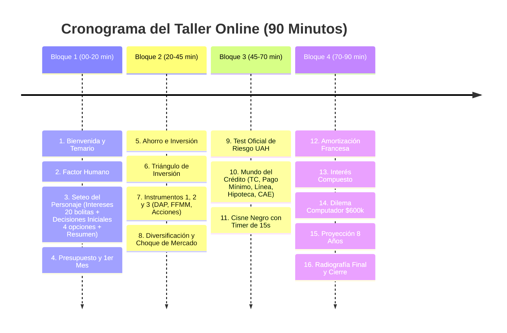

# 17. Guión Integrado del Taller (90 Minutos): Presentación & Simulador Web

> *"El taller no es una charla con un juego al final; es una experiencia pedagógica interactiva donde cada diapositiva teórica se vive inmediatamente en la aplicación."*

* **Modalidad:** Taller Online en Vivo.
* **Duración Total:** 90 Minutos.
* **Audiencia Estimada:** ~20 Participantes (individuales, en parejas o grupos familiares).
* **Dinámica:** El facilitador expone y guía la sesión; la aplicación web avanza sincronizada respondiendo a los temas explicados.

> [!NOTE]
> **Alineación con el Código del Taller:**  
> Este guión refleja fielmente el flujo implementado en la aplicación web (`index.html`). En la fase de onboarding inicial se **eliminó la selección de perfiles predeterminados**; los participantes construyen su identidad en 3 pasos sucesivos (**Intereses**, **Decisiones Iniciales** y **Ficha Resumen**). El HUD dock bar inferior dispone de los **7 Lugares oficiales** (según `Opciones iconos.txt`), que al tocarse abren una vitrina en 2 columnas en Modo Claro.

---

## ⏱️ Mapa de Tiempo Global (90 Minutos)

---

## 📋 Los 34 Pasos Integrados: Presentación vs. Simulador Web

Los pasos marcados con **[\*]** representan una interacción activa del participante en la aplicación web o un evento sincronizado:

| # | Hito del Taller | Qué hace el Facilitador en la Presentación | Qué ocurre en la App del Participante | Qué controla el Facilitador en su Consola | Min |
| :-: | :--- | :--- | :--- | :--- | :-: |
| **1\*** | **Tus Intereses Personales** | Da la bienvenida, explica cómo los valores y gustos personales condicionan las finanzas y da la partida. | **Diapositiva 1 • Lengüeta `1 Intereses`:** Distribuye sus **20 bolitas de interés** (11 iniciales + 9 libres, escala de 1 a 3 bolitas) en las 11 categorías de vida en un listado simple. | Monitorea el ingreso de los ~20 participantes y avance de bolitas. | 00-05 |
| **2\*** | **Decisiones Iniciales: Vivienda, Trabajo y Transporte** | Explica cómo las anclas estructurales fijan los costos mensuales antes de recibir el sueldo. | **Diapositiva 2 • Lengüeta `2 Decisiones iniciales`:** Selecciona 1 opción en cada una de las 3 áreas (4 opciones por punto: Vivienda, Trabajo, Transporte). | Verifica que todos hayan completado las 3 selecciones obligatorias. | 05-09 |
| **3\*** | **Resumen de tu Personaje** | Pide a cada participante revisar su punto de partida y reflexionar sobre su diagnóstico inicial. | **Diapositiva 3 • Lengüeta `3 Resumen`:** Revisa su ficha consolidada (decisiones, prioridades y diagnóstico de partida). Pulsa *"Comenzar Taller"*. | Da la orden de inicio oficial del recorrido formativo. | 09-12 |
| **4** | **Introducción: Finanzas & Factor Humano** | Explica por qué fallan las planillas frías y el rol que juegan las emociones en el manejo del dinero. | Pantalla de transición conceptual y lectura de cita formativa. | Mantiene sincronizado el avance del grupo. | 12-15 |
| **5\*** | **Presupuesto Inteligente: "Págate a ti primero"** | Expone la regla de oro: separar el ahorro antes de gastar (50% Fijos, 30% Estilo de Vida, 20% Reservas). | **Diapositiva 5:** Organiza su **primer sueldo líquido ($1.600.000 CLP)** ajustando los porcentajes de asignación. | Visualiza en vivo cómo distribuyó el presupuesto el grupo. | 15-20 |
| **6\*** | **Primer Mes: Pago de Gastos y Realidad** | Explica la diferencia entre lo proyectado en el papel y los débitos reales de la vida cotidiana. | **Se procesa el 1er Mes:** El sistema descuenta compromisos de vivienda y transporte. Se observa la liquidez real disponible. | Dispara la orden: *"Ejecutar Mes 1"*. Detecta márgenes estrechos. | 20-23 |
| **7** | **Ahorro, Inversión y Crédito: Los 7 Lugares** | Presenta el ecosistema financiero: guardar, multiplicar o pedir prestado. | La app habilita el **HUD Dock Bar con los 7 Lugares** (Banco, Otras Inversiones, Corredora, Comercio, Actividades, Trabajo, Mi Estado). | Muestra el mapa en la pantalla compartida. | 23-26 |
| **8** | **Consideraciones al Ahorrar e Invertir** | Explica los 3 pilares indispensables: **Rentabilidad**, **Liquidez** y **Riesgo**. | Gráfico conceptual interactivo del triángulo en la app. | Desbloquea información de apoyo. | 26-29 |
| **9\*** | **El Triángulo de la Inversión** | Explica por qué *"ninguna inversión maximiza rentabilidad, liquidez y seguridad a la vez"*. | **Diapositiva 9:** Simulador interactivo: mueve el puntero y activa presets (DAP, Fondos Mutuos, Acciones) con veredicto pedagógico. | Sincroniza el ejercicio práctico en la sala. | 29-32 |
| **10** | **Ahorro y Guardar Dinero (Fondos con Propósito)** | Explica por qué no basta con dejar el dinero en la cuenta corriente y la necesidad de separar fondos. | La app permite clasificar reservas (Emergencias, Anuales, Oportunidades). | Observa cuántos crearon fondos específicos. | 32-35 |
| **11\***| **Evento de Estilo de Vida y Bienestar** | Pausa la exposición y pide mirar la pantalla: la vida reclama presupuesto según las pasiones del participante. | **Diapositiva 11:** Dilema del torneo de pádel ($85.000 cash vs 3 cuotas con tarjeta vs no asistir). Impacta en dinero y Paz Mental. | Dispara: *"Lanzar Evento de Bienestar"*. | 35-38 |
| **12\***| **Instrumentos de Ahorro: Renta Fija (DAP)** | Explica los **Depósitos a Plazo (30 a 360 días)** con capital 100% garantizado por ley (garantía estatal CMF). | **Diapositiva 12:** Simulación de inversión en DAP a 90 días con tasa garantizada de 4.8% anual. | Habilita módulo de simulación de DAP. | 38-41 |
| **13\***| **Instrumentos Balanceados: Fondos Mutuos y Cuenta 2** | Explica la diversificación profesional y la liquidez en 48 horas de la Cuenta 2 AFP y Fondos Mutuos. | La app permite simular un aporte a fondos balanceados moderados. | Monitorea suscripciones en la app. | 41-44 |
| **14\***| **Renta Variable y Alternativos (Acciones y Cripto)** | Explica el potencial de apreciación a largo plazo y la volatilidad severa de acciones y activos digitales. | Opcional en app: colocar excedentes en renta variable asumiendo riesgo. | Explica las diferencias de riesgo/retorno. | 44-47 |
| **15** | **No Poner Todos los Huevos en la Misma Canasta** | Explica los 4 ejes de diversificación: por instrumento, por plazo, por sector y por institución. | Visualización de la torta de distribución patrimonial del usuario. | Prepara el evento de estrés de mercado. | 47-50 |
| **16\***| **Evento Simulador: Choque de Mercado** | El relator anuncia una caída súbita del 20% en el sector tecnológico o recesión económica. | **Diapositiva 16:** Impacto en inversiones: quien diversificó amortigua el golpe; quien concentró en acciones/cripto sufre pérdidas agudas. | Dispara: *"Evento Choque de Mercado"*. | 50-53 |
| **17** | **El Perfil de Riesgo: Paz Mental al Invertir** | Introduce la noción de perfil de riesgo: la cartera correcta es la que te deja dormir en paz por las noches. | Pantalla de transición al test de riesgo oficial. | Prepara el test en la consola central. | 53-55 |
| **18\***| **Test de Perfil de Riesgo (Test Oficial UAH / Experian)** | Invita a responder con honestidad las preguntas del test oficial de inversor. | **Diapositiva 18:** Responden el test de 5 preguntas. La app calcula su perfil: Conservador (5-8), Moderado (9-11) o Arriesgado (12-15). | Proyecta la distribución del grupo (% Conservador / Moderado / Arriesgado). | 55-58 |
| **19** | **Reflexión sobre Perfiles y Portafolios** | Analiza por qué un perfil conservador no debe tener cripto ni un joven con horizonte lejano solo DAP. | La app entrega recomendaciones de portafolio coherentes con el resultado del test. | Comenta contrastes en pantalla compartida. | 58-61 |
| **20** | **El Mundo del Crédito: Tipos y Mecánicas** | Define el crédito como adelantar consumo presente comprometiendo ingresos futuros con costo financiero. | Desbloqueo del catálogo de productos de crédito en la app. | Habilita módulo de créditos. | 61-63 |
| **21\***| **Tarjetas de Crédito y la Trampa del Pago Mínimo** | Explica el interés rotativo (25% a 45% anual) y la capitalización de intereses si solo se paga el mínimo. | **Diapositiva 21:** Simulador de tarjeta ($450.000 de deuda): pagar total hoy vs pagar mínimo de $25.000 (tarda 4 años y paga $890.000). | Muestra cuántos comprendieron el impacto del pago mínimo. | 63-66 |
| **22\***| **Línea de Crédito y Sobregiro** | Explica el uso de emergencia de la línea de crédito vs su altísimo costo por intereses diarios. | Decisión en app: evaluar activación o uso preventivo de línea de crédito. | Monitorea el uso de líneas bancarias. | 66-68 |
| **23\***| **Crédito Hipotecario y Bienes Raíces** | Explica dividendos a 20-30 años, la importancia del pie y los seguros asociados (desgravamen, sismo, incendio). | Decisión en app: evaluar adquisición de activos o seguros hipotecarios. | Habilita módulo de activos inmobiliarios. | 68-71 |
| **24\***| **Crédito de Consumo: Cuotas Fijas** | Explica préstamos personales a cuotas fijas para consolidación de pasivos o proyectos mayores. | Simulación de solicitud de crédito de consumo en cuotas. | Habilita crédito de consumo en el banco. | 71-73 |
| **25\***| **El CAE (Costo Anual Equivalente)** | Enseña a comparar créditos por el CAE y el Costo Total del Crédito (CTC) y no por la tasa nominal. | **Diapositiva 25:** Comparador de 3 ofertas con el mismo monto para identificar la opción de menor CAE. | Lanza el ejercicio interactivo de CAE. | 73-76 |
| **26\***| **El Cisne Negro: Imprevistos Mayores (15s)** | El facilitador activa una emergencia súbita real (urgencia médica, pana mecánica o filtración de cañería). | **Diapositiva 26:** **Temporizador de 15 segundos** con barra decreciente. Debe pagar entre $380k y $1.2M: ¿Fondo líquido, cuotas o mora? | Dispara: *"Lanzar Cisne Negro"*. Ve quién contaba con fondo de reserva. | 76-79 |
| **27** | **Sistema de Amortización Francés** | Explica por qué en las primeras cuotas casi todo es interés y muy poco capital. | Gráfico visual interactivo de la curva francesa en la app. | Proyecta la tabla de desarrollo del crédito. | 79-82 |
| **28** | **Interés Simple vs. Interés Compuesto** | Explica cómo el interés compuesto multiplica la riqueza al ahorrar y destruye el patrimonio al sobreendeudarse. | Simulador visual interactivo de ambas curvas exponenciales. | Desbloquea la comparación visual. | 82-84 |
| **29\***| **Impacto del Interés en el Tiempo** | Muestra cómo evolucionaron las deudas impagas vs las inversiones sistemáticas del grupo. | Actualización de saldos: dinero perdido en intereses vs ganado en rentabilidad. | Dispara: *"Capitalizar Intereses del Período"*. | 84-86 |
| **30\***| **Dilema Real: Renovar Computador de $600.000 CLP** | Plantea el dilema práctico: ¿Ahorrar $50.000/mes durante 12 meses o comprar en 12 cuotas de $56.250 hoy? | **Diapositiva 30:** Encuesta y votación interactiva: Opción A (Ahorro programado) vs Opción B (Comprar a crédito hoy). | Proyecta los porcentajes de votación de la sala. | 86-88 |
| **31\***| **Revisión General del Tablero** | Invita a revisar el estado financiero y emocional del personaje antes de la proyección final. | Consulta de indicadores consolidados en la app (Patrimonio, Paz Mental, Deuda). | Analiza el estado agregado de la sala. | 88-89 |
| **32\***| **Ajustes Finales del Participante** | Concede 60 segundos para prepagar tarjetas, reasignar fondos o amortizar deudas pendientes. | Los participantes aplican sus últimas decisiones estratégicas de salvataje. | Conteo regresivo de 60 segundos en la consola. | 89-90 |
| **33\***| **Proyección Acelerada a 8 Años** | Dispara la proyección temporal: el motor simula el efecto compuesto de sus hábitos a lo largo de 8 años de vida. | **Diapositiva 33:** Animación de avance acelerado y despliegue de la **Radiografía Final a 8 Años**. | Dispara: *"Ejecutar Proyección 8 Años"*. | 90-92 |
| **34** | **Debate Grupal, Lecciones y Cierre** | Guía la reflexión final: ¿Quién logró el equilibrio entre patrimonio y paz mental? Conclusiones del taller. | Visualización de insignias obtenidas (*Arquitecto de Libertad*, *Equilibrista*, etc.) y resumen de lecciones. | Cierra la sesión y despide el taller. | 92-95 |

---

## 4. Beneficios Pedagógicos del Flujo Integrado de 90 Minutos

1. **Ritmo y Dinamismo Constante:** La alternancia de 3 a 4 minutos de exposición conceptual con 2 a 3 minutos de interacción directa en la pantalla mantiene la atención al máximo sin dispersión.
2. **Aplicación Inmediata del Concepto:** Cuando se enseña el CAE, los participantes evalúan ofertas reales en su pantalla. Cuando se aborda el fondo de emergencias, sufren o se salvan en la crisis del Cisne Negro con temporizador de 15 segundos.
3. **Decisiones Reales y Personalizadas:** El participante construye su personaje desde sus gustos auténticos (bolitas) y sus decisiones iniciales de vida (vivienda, trabajo y transporte), logrando un anclaje emocional duradero.
