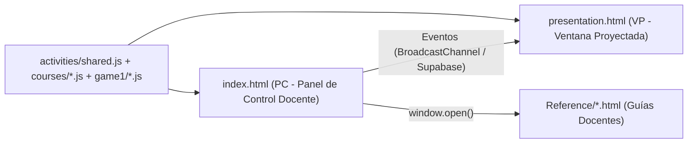

# Arquitectura — Calen English Class (`englishCalen2026`)

*¿Cómo se comunica y fluye?*

## 1. Arquitectura de Doble Ventana Sincronizada
El sistema opera dividiendo la experiencia en dos ventanas independientes del navegador que se comunican en tiempo real sin recargar la página:

## 2. Flujo de Datos y Renderizado
1. **Carga de Datos Estáticos:** Tanto `index.html` como `presentation.html` cargan `activities/shared.js`, los módulos de curso (`courses/5to-6to.js`, `courses/7mo-8vo.js`) y los scripts de `game1/`.
2. **Emisión de Comandos (`send(type, payload)`):** Cuando el profesor selecciona estudiantes, activa una pregunta, muestra una imagen o elige palabras en `index.html`, se emite un mensaje con el tipo de acción y sus datos.
3. **Renderizado en la VP (`presentation.html`):**
   - ** Textos y Turnos (PI):** Actualiza `#names` (estudiantes activos), `#middle` (pregunta/estímulo) y `#bottom` (respuesta revelada).
   - **Actividad `photo-word`:** El PC envía las palabras seleccionadas unidas por salto de línea (`shown.join('\n')`). La VP divide el payload por `[\n|]+`, filtra vacíos y crea un `
` por palabra dentro de `.photo-panel-words` (`display: flex; flex-direction: column; gap: 16px; align-items: center; justify-content: center;`).
   - **Cámara y Juego (PS):** Procesa el stream de video local con MediaPipe (`selfie_segmenter.tflite`) o renderiza las vistas de `game1` y `StoryImages/`.
