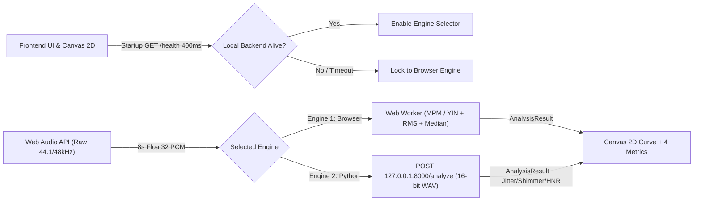

# Architecture — `trino`

## 1. Hybrid Dual-Engine Flow

## 2. Component Boundaries
1. **Capture Layer (`js/audio-capture.js`):** Manages microphone stream with disabled voice filters, records `8s` PCM buffer, and encodes `16-bit` mono WAV when Engine 2 or audio download is needed.
2. **Analysis Layer:**
   - **Browser Worker (`js/pitch-worker.js`):** Runs off-main-thread time-domain pitch detection so UI never freezes.
   - **Local FastAPI (`backend/main.py`):** Exposes `GET /health` (CORS enabled for `localhost` / `127.0.0.1`) and `POST /analyze`.
3. **Presentation Layer (`js/canvas-renderer.js` & `js/app.js`):** Consumes `AnalysisResult` agnostically, drawing the $\pm 100\text{ cents}$ canvas grid and metric cards.
